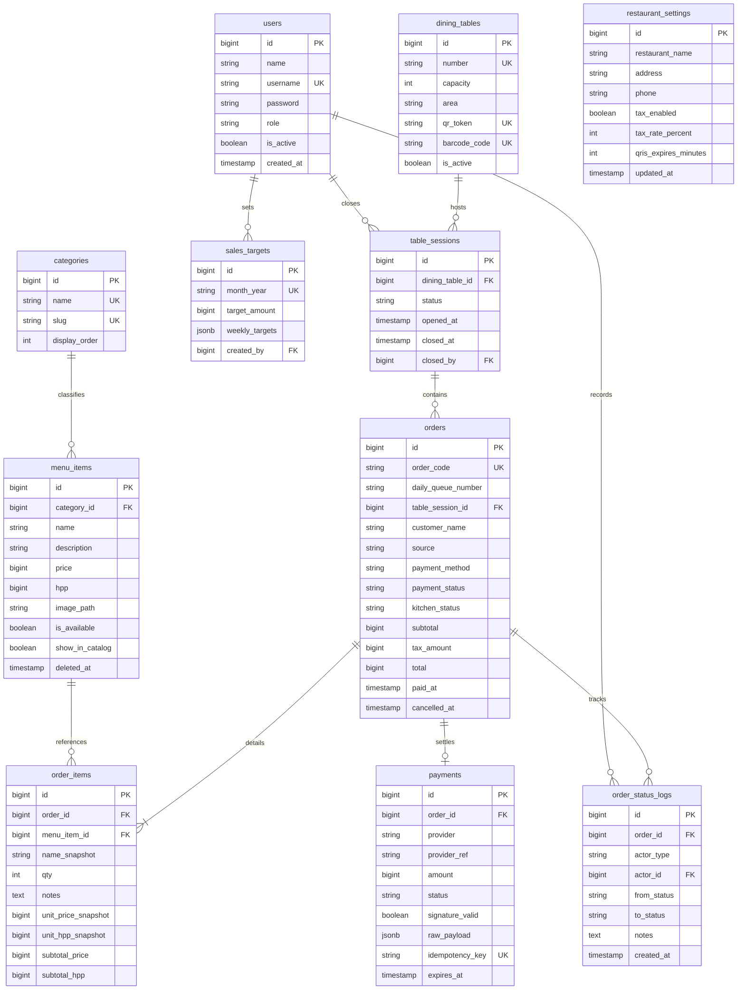
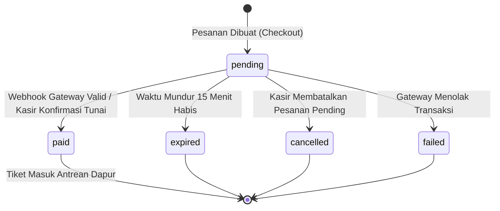
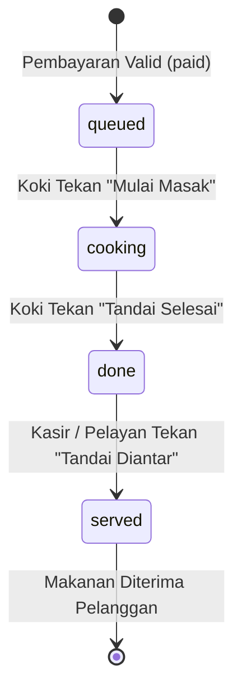
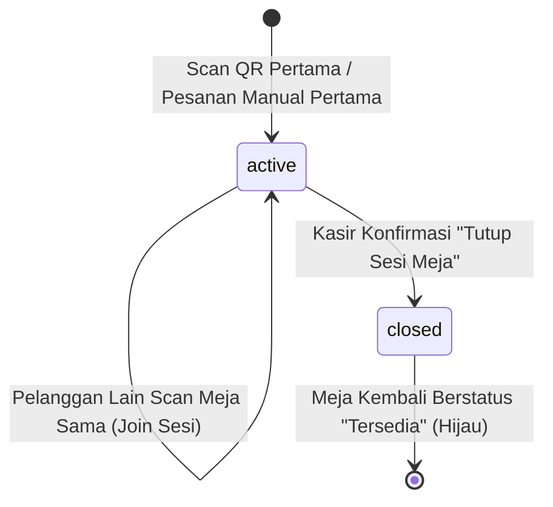
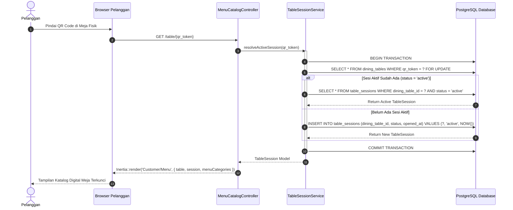
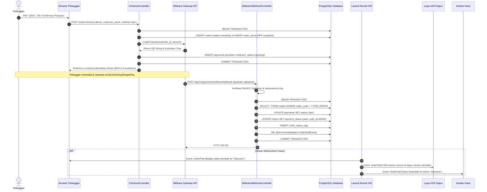
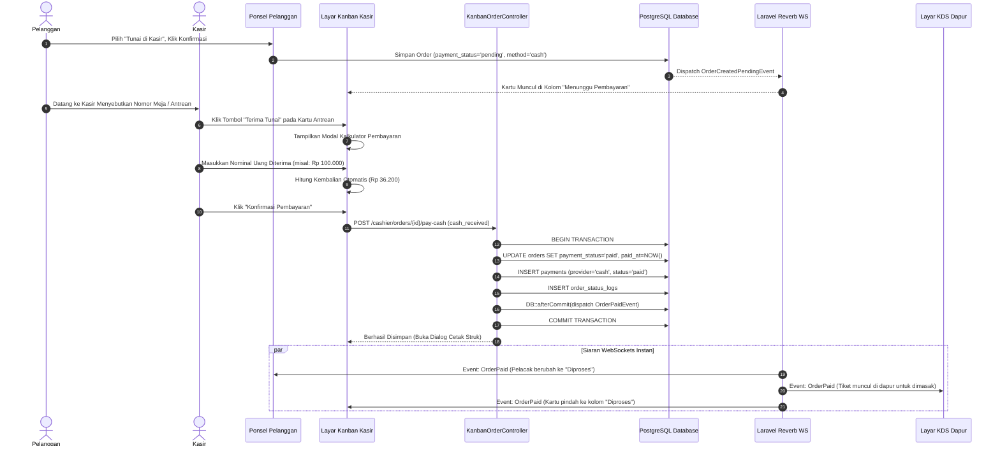
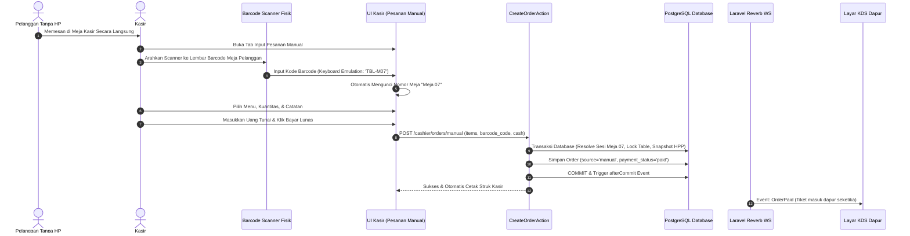
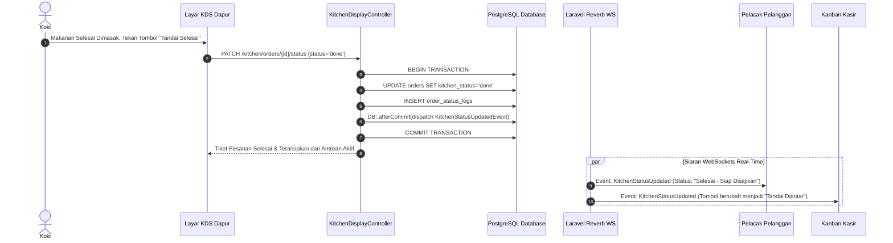
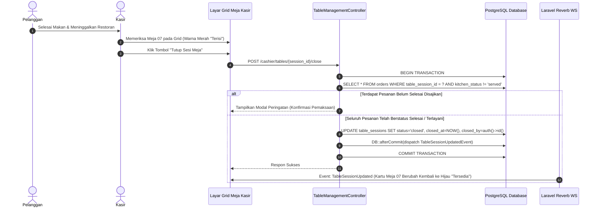

# Arsitektur Sistem MICRODINE

> **Inovasi Platform Manajemen Restoran Terpadu untuk Mendorong Kemandirian Digital Bisnis Mikro Indonesia**  
> **Versi Dokumen**: 1.1 (Aligned with Laravel 13 & React 19 Frontend Implementation)  
> **Tumpukan Teknologi**: Laravel 13.x Monolitik (PHP 8.3+) + React 19+ (Inertia.js v3) + PostgreSQL 16+ + Laravel Reverb (WebSockets) + Tailwind CSS v4

---

## 1. Diagram Arsitektur Sistem Global

MICRODINE mengadopsi arsitektur **Monolitik Terintegrasi (*Single Codebase Monolith*)** yang menggabungkan logika bisnis *backend* (Laravel) dan antarmuka pengguna *Single Page Application* (React) melalui protokol **Inertia.js v3** (`@inertiajs/react ^3.11.0`). Pendekatan ini mengeliminasi kompleksitas pemeliharaan REST API publik terpisah, menjamin integritas transaksi finansial yang ketat, serta memungkinkan komunikasi dua arah seketika (*real-time*) tanpa ketergantungan pada layanan SaaS pihak ketiga berbayar.

```mermaid
graph TD
    subgraph KLIEN["Peramban Klien (Frontend React SPA)"]
        ClientCustomer["Pelanggan (Mobile-First)\n- Scan QR Meja\n- Katalog & Keranjang\n- Pay-First QRIS/Tunai\n- Status Pesanan Real-Time"]
        ClientCashier["Kasir (Desktop/Tablet)\n- Kanban Antrean Pesanan\n- Kalkulator Bayar Tunai\n- Barcode Scanner Meja\n- Manajemen Status Meja\n- Histori & Cetak Struk"]
        ClientKitchen["Dapur (Tablet KDS)\n- Layar Pemantauan KDS\n- Tiket Pesanan Lunas\n- Kontrol Progres Masak\n- Live Status Otomatis"]
        ClientAdmin["Admin (Desktop)\n- Ringkasan Finansial\n- Master Menu & HPP\n- Audit Snapshot Laporan\n- Pengaturan & Target"]
    end

    subgraph WEBSERVER["Web & Reverse Proxy"]
        Nginx["Nginx Web Server\n- Port 80 / 443 (HTTP/HTTPS)\n- Reverse Proxy ke Port 8080 (WS)"]
    end

    subgraph APLIKASI["Aplikasi Inti (Laravel 11 Monolith)"]
        InertiaAdapter["Inertia.js Adapter\n(Routing & State Hydration)"]
        HTTPControllers["HTTP Controllers\n(Thin Controllers per Peran)"]
        DomainServices["Domain Services & Actions\n(Order, Payment, TableSession, Reporting)"]
        ReverbServer["Laravel Reverb WS Server\n(Port 8080 - Native WebSockets)"]
        QueueWorker["Supervisor Queue Worker\n(Pemrosesan Asinkron & Audit)"]
    end

    subgraph INTEGRASI["Layanan Eksternal"]
        PaymentGateway["Midtrans Payment Gateway\n- QRIS Dinamis API\n- Inbound Webhook Callback"]
    end

    subgraph BASISDATA["Penyimpanan Data Terpusat"]
        PostgreSQL[("PostgreSQL 16+\n- Row-Level Locking (lockForUpdate)\n- Partial Unique Index (1 Meja 1 Sesi)\n- Snapshot Transaksi Finansial")]
    end

    %% Relasi Antar Komponen
    KLIEN -->|HTTPS Requests| Nginx
    Nginx -->|FastCGI / PHP-FPM| InertiaAdapter
    InertiaAdapter --> HTTPControllers
    HTTPControllers --> DomainServices
    DomainServices -->|SQL Queries & Locks| PostgreSQL
    DomainServices -->|DB::afterCommit Dispatch| ReverbServer
    DomainServices -->|API Calls (Create QRIS)| PaymentGateway
    PaymentGateway -->|Webhook Callback| Nginx
    DomainServices -->|Dispatch Jobs| QueueWorker
    QueueWorker --> PostgreSQL

    %% Relasi Real-Time
    KLIEN <-->|WebSocket Connection / Echo| Nginx
    Nginx <-->|Proxy WebSocket| ReverbServer
```

---

## 2. Struktur Folder Lengkap & Konvensi Penamaan

Struktur direktori dirancang modular dan memisahkan tanggung jawab berdasarkan domain fungsional (*Clean Separation of Concerns*):

```
MICRODINE/
├── app/
│   ├── Actions/                       # Kelas aksi perintah tunggal (Single-purpose)
│   │   ├── Orders/
│   │   │   ├── CreateOrderAction.php
│   │   │   ├── ProcessCashPaymentAction.php
│   │   │   └── CancelOrderAction.php
│   │   ├── Tables/
│   │   │   ├── InitializeTableSessionAction.php
│   │   │   └── CloseTableSessionAction.php
│   │   └── Menus/
│   │       ├── CreateMenuItemAction.php
│   │       └── UpdateMenuItemAction.php
│   ├── Services/                      # Logika bisnis domain yang kompleks
│   │   ├── OrderService.php           # Validasi pesanan, pembuatan nomor antrean
│   │   ├── PaymentService.php         # Transaksi finansial, validasi webhook
│   │   ├── TableSessionService.php    # Penguncian meja fisik, pencegahan double-booking
│   │   ├── FinancialReportService.php # Agregasi omzet & HPP berbasis data snapshot
│   │   └── Gateways/                  # Abstraksi Payment Gateway
│   │       ├── PaymentGatewayInterface.php
│   │       ├── MidtransPaymentGateway.php
│   │       └── SimulatedPaymentGateway.php # Simulasi untuk presentasi demo offline
│   ├── Events/                        # Siaran WebSockets (Broadcast Events)
│   │   ├── OrderCreatedPendingEvent.php
│   │   ├── OrderPaidEvent.php
│   │   ├── KitchenStatusUpdatedEvent.php
│   │   ├── TableSessionUpdatedEvent.php
│   │   └── OrderCancelledEvent.php
│   ├── Http/
│   │   ├── Controllers/               # Thin Controllers (hanya me-render Inertia atau melempar ke Service)
│   │   │   ├── Auth/
│   │   │   │   └── AuthenticatedSessionController.php
│   │   │   ├── Customer/
│   │   │   │   ├── MenuCatalogController.php
│   │   │   │   ├── CartController.php
│   │   │   │   ├── CheckoutController.php
│   │   │   │   └── OrderTrackingController.php
│   │   │   ├── Cashier/
│   │   │   │   ├── KanbanOrderController.php
│   │   │   │   ├── TableManagementController.php
│   │   │   │   └── TransactionHistoryController.php
│   │   │   ├── Kitchen/
│   │   │   │   └── KitchenDisplayController.php
│   │   │   ├── Admin/
│   │   │   │   ├── DashboardAnalyticsController.php
│   │   │   │   ├── MenuManagementController.php
│   │   │   │   ├── FinancialReportController.php
│   │   │   │   ├── RestaurantSettingsController.php
│   │   │   │   ├── CashierAccountController.php
│   │   │   │   └── SalesTargetController.php
│   │   │   └── Webhooks/
│   │   │       └── MidtransWebhookController.php
│   │   ├── Middleware/                # Otorisasi & Filter Akses
│   │   │   ├── EnsureUserRole.php     # RBAC (admin, kasir, dapur)
│   │   │   ├── VerifyTableToken.php   # Validasi sesi meja pelanggan
│   │   │   └── HandleInertiaRequests.php
│   │   └── Requests/                  # FormRequest Validasi
│   │       ├── Customer/CheckoutRequest.php
│   │       ├── Cashier/CashValidationRequest.php
│   │       └── Admin/MenuItemRequest.php
│   ├── Models/                        # Eloquent Models dengan strict typing & casting
│   │   ├── User.php
│   │   ├── RestaurantSetting.php
│   │   ├── Category.php
│   │   ├── MenuItem.php
│   │   ├── DiningTable.php
│   │   ├── TableSession.php
│   │   ├── Order.php
│   │   ├── OrderItem.php
│   │   ├── Payment.php
│   │   ├── OrderStatusLog.php
│   │   └── SalesTarget.php
│   └── Enums/                         # PHP 8.2 Backed Enums
│       ├── UserRole.php               # 'admin', 'kasir', 'dapur'
│       ├── PaymentMethod.php          # 'cash', 'qris'
│       ├── PaymentStatus.php          # 'pending', 'paid', 'failed', 'cancelled', 'expired'
│       ├── KitchenStatus.php          # 'queued', 'cooking', 'done', 'served'
│       ├── TableSessionStatus.php     # 'active', 'closed'
│       └── OrderSource.php            # 'qr', 'manual'
├── resources/js/
│   ├── Layouts/                       # Pembungkus tampilan per peran
│   │   ├── CustomerLayout.jsx         # Mobile-first wrapper, bottom action bar
│   │   ├── CashierLayout.jsx          # Header kasir, indikator online/offline, navigasi
│   │   ├── KitchenLayout.jsx          # KDS full-screen bar, status koneksi live
│   │   └── AdminLayout.jsx            # Sidebar 240px navy, grup navigasi eksekutif
│   ├── Pages/                         # Komponen Tampilan Inertia per Peran
│   │   ├── Customer/
│   │   │   ├── Menu.jsx               # Katalog produk, filter kategori, search bar
│   │   │   ├── Cart.jsx               # Keranjang pesanan, ringkasan pajak
│   │   │   ├── Checkout.jsx           # Form nama, pilih QRIS vs Tunai
│   │   │   ├── Payment.jsx            # QRIS view, countdown timer 15 menit
│   │   │   └── OrderStatus.jsx        # Pelacak antrean visual real-time
│   │   ├── Auth/
│   │   │   └── Login.jsx              # Portal staf terpusat (/staf/masuk: Tab Kasir & Admin)
│   │   ├── Cashier/
│   │   │   ├── Orders.jsx             # Papan Kanban & Modal Kalkulator Tunai
│   │   │   ├── Tables.jsx             # Grid meja (Tersedia hijau / Terisi merah)
│   │   │   └── History.jsx            # Audit harian, panel detail, cetak struk
│   │   ├── Kitchen/
│   │   │   └── Display.jsx            # KDS tiket besar, tombol status masakan (/dapur)
│   │   ├── Admin/
│   │   │   ├── Dashboard.jsx          # Analitik omzet, HPP, laba 14 hari
│   │   │   ├── Menu.jsx               # Master menu & modal kalkulator margin
│   │   │   ├── Reports.jsx            # Audit transaksi historis & export
│   │   │   ├── Settings.jsx           # Pajak daerah PBJT/PB1 & kelola meja
│   │   │   ├── Cashiers.jsx           # CRUD staf kasir
│   │   │   └── Targets.jsx            # Target omzet bulanan & proyeksi harian
│   │   └── Welcome.jsx                # Landing page selamat datang & pemilih peran demo
│   ├── Components/
│   │   ├── UI/                        # Komponen UI dasar
│   │   │   ├── Button.jsx, Input.jsx, Card.jsx, Modal.jsx, Table.jsx, Toggle.jsx
│   │   │   ├── StatCard.jsx, TrendChart.jsx, TargetComparisonChart.jsx
│   │   │   └── PaymentDistributionChart.jsx, TopSellingList.jsx
│   │   └── Shared/                    # Komponen komposit domain
│   │       ├── Navbar.jsx, Sidebar.jsx, CashPaymentModal.jsx, SearchBar.jsx
│   │       ├── Pagination.jsx, ReceiptModal.jsx, DishDetailModal.jsx
│   │       └── Toast.jsx, OfflineBanner.jsx
│   ├── Hooks/                         # Custom React Hooks
│   │   ├── useCart.js                 # Keranjang belanja & subtotal
│   │   ├── useCountdown.js            # Timer mundur pembayaran QRIS
│   │   └── useCurrency.js             # Formatter rupiah integer
│   ├── Utils/                         # Utility helpers
│   │   ├── formatters.js              # Format mata uang & tanggal WIB
│   │   ├── sound.js                   # Efek suara bel tiket pesanan baru
│   │   └── storage.js                 # LocalStorage persistence wrapper
│   ├── Data/mock/                     # Mock dataset prototipe UI
│   │   ├── menus.js, orders.js, reports.js, restaurant.js, staff.js, tables.js
│   │   └── index.js
│   ├── Echo.js                        # Konfigurasi inisialisasi Laravel Echo / Reverb
│   └── app.jsx                        # Entrypoint Vite / Inertia React 19
```

---

## 3. Skema Basis Data Relasional PostgreSQL

### 3.1 Diagram Hubungan Entitas (Entity-Relationship Diagram)



### 3.2 Spesifikasi Detail Tabel & Konstrain Basis Data

#### 1. Tabel `users`
| Kolom | Tipe Data | Keterangan |
| :--- | :--- | :--- |
| `id` | `BIGSERIAL PRIMARY KEY` | ID Pengguna unik |
| `name` | `VARCHAR(100) NOT NULL` | Nama lengkap staf |
| `username` | `VARCHAR(50) NOT NULL UNIQUE` | Kredensial masuk portal |
| `password` | `VARCHAR(255) NOT NULL` | Password ter-hash (Bcrypt / Argon2id) |
| `role` | `VARCHAR(20) NOT NULL` | Enums: `admin`, `kasir`, `dapur` |
| `is_active` | `BOOLEAN NOT NULL DEFAULT TRUE`| Status keaktifan akun |
| `created_at`, `updated_at` | `TIMESTAMP WITH TIME ZONE` | WIB (`Asia/Jakarta`) |

#### 2. Tabel `restaurant_settings`
| Kolom | Tipe Data | Keterangan |
| :--- | :--- | :--- |
| `id` | `BIGSERIAL PRIMARY KEY` | Baris tunggal (*singleton record*) |
| `restaurant_name` | `VARCHAR(100) NOT NULL` | Nama restoran (tampil pada struk & header) |
| `address` | `TEXT NULL` | Alamat fisik restoran |
| `phone` | `VARCHAR(30) NULL` | Nomor kontak restoran |
| `tax_enabled` | `BOOLEAN NOT NULL DEFAULT TRUE`| Sakelar pajak daerah PBJT/PB1 |
| `tax_rate_percent` | `INT NOT NULL DEFAULT 10` | Tarif persentase pajak (misal 10%) |
| `qris_expires_minutes` | `INT NOT NULL DEFAULT 15` | Waktu mundur kedaluwarsa QRIS |

#### 3. Tabel `categories`
| Kolom | Tipe Data | Keterangan |
| :--- | :--- | :--- |
| `id` | `BIGSERIAL PRIMARY KEY` | ID Kategori |
| `name` | `VARCHAR(50) NOT NULL UNIQUE` | Nama kategori (Makanan, Minuman, Camilan) |
| `slug` | `VARCHAR(60) NOT NULL UNIQUE` | Slug URL |
| `display_order` | `INT NOT NULL DEFAULT 0` | Urutan penataan pada antarmuka |

#### 4. Tabel `menu_items`
| Kolom | Tipe Data | Keterangan |
| :--- | :--- | :--- |
| `id` | `BIGSERIAL PRIMARY KEY` | ID Menu |
| `category_id` | `BIGINT NOT NULL REFERENCES categories(id)` | Relasi kategori produk |
| `name` | `VARCHAR(150) NOT NULL` | Nama menu masakan |
| `description` | `TEXT NULL` | Deskripsi singkat |
| `price` | `BIGINT NOT NULL` | Harga jual (*integer Rupiah*, >= 0) |
| `hpp` | `BIGINT NOT NULL` | Modal HPP statis (*integer Rupiah*, >= 0) |
| `image_path` | `VARCHAR(255) NULL` | Path berkas foto menu |
| `is_available` | `BOOLEAN NOT NULL DEFAULT TRUE` | Ketersediaan dapur (*in stock*) |
| `show_in_catalog` | `BOOLEAN NOT NULL DEFAULT TRUE` | Sakelar penayangan pada katalog |
| `deleted_at` | `TIMESTAMP WITH TIME ZONE NULL` | Dukungan *Soft Deletes* |

#### 5. Tabel `dining_tables`
| Kolom | Tipe Data | Keterangan |
| :--- | :--- | :--- |
| `id` | `BIGSERIAL PRIMARY KEY` | ID Meja fisik |
| `number` | `VARCHAR(10) NOT NULL UNIQUE` | Nomor fisik meja (misal: "07", "Meja 01") |
| `capacity` | `INT NOT NULL DEFAULT 4` | Kapasitas kursi |
| `area` | `VARCHAR(50) NOT NULL DEFAULT 'Area Dalam'` | Lokasi (Area Dalam, Teras) |
| `qr_token` | `VARCHAR(64) NOT NULL UNIQUE` | Token acak kriptografis 32-char (akses QR) |
| `barcode_code` | `VARCHAR(32) NOT NULL UNIQUE` | Kode barcode fisik untuk scanner kasir |
| `is_active` | `BOOLEAN NOT NULL DEFAULT TRUE` | Status operasional meja |

#### 6. Tabel `table_sessions`
| Kolom | Tipe Data | Keterangan |
| :--- | :--- | :--- |
| `id` | `BIGSERIAL PRIMARY KEY` | ID Sesi meja |
| `dining_table_id` | `BIGINT NOT NULL REFERENCES dining_tables(id)` | Relasi meja fisik |
| `status` | `VARCHAR(20) NOT NULL DEFAULT 'active'` | Enums: `active`, `closed` |
| `opened_at` | `TIMESTAMP WITH TIME ZONE NOT NULL` | Waktu sesi dibuka |
| `closed_at` | `TIMESTAMP WITH TIME ZONE NULL` | Waktu sesi ditutup kasir |
| `closed_by` | `BIGINT NULL REFERENCES users(id)` | Kasir penutup sesi |

> [!IMPORTANT]
> **Konstrain Mesin Basis Data (Partial Unique Index)**:
> ```sql
> CREATE UNIQUE INDEX unique_active_table_session 
> ON table_sessions (dining_table_id) 
> WHERE status = 'active';
> ```
> Indeks parsial ini menggaransi secara absolut di tingkat PostgreSQL bahwa tidak akan pernah ada lebih dari satu sesi meja berstatus `active` untuk meja yang sama, meniadakan risiko *race condition* atau sesi ganda (*double-booking*).

#### 7. Tabel `orders`
| Kolom | Tipe Data | Keterangan |
| :--- | :--- | :--- |
| `id` | `BIGSERIAL PRIMARY KEY` | ID Transaksi pesanan |
| `order_code` | `VARCHAR(20) NOT NULL UNIQUE` | Kode audit pesanan (misal: "ORD-0148") |
| `daily_queue_number`| `VARCHAR(10) NOT NULL` | Nomor antrean harian (misal: "A-024") |
| `table_session_id` | `BIGINT NOT NULL REFERENCES table_sessions(id)` | Sesi meja aktif terkait |
| `customer_name` | `VARCHAR(100) NOT NULL` | Nama pemesan |
| `source` | `VARCHAR(10) NOT NULL` | Enums: `qr` (pelanggan), `manual` (kasir) |
| `payment_method` | `VARCHAR(10) NOT NULL` | Enums: `cash`, `qris` |
| `payment_status` | `VARCHAR(20) NOT NULL DEFAULT 'pending'`| Enums: `pending`, `paid`, `failed`, `cancelled`, `expired` |
| `kitchen_status` | `VARCHAR(20) NOT NULL DEFAULT 'queued'` | Enums: `queued`, `cooking`, `done`, `served` |
| `subtotal` | `BIGINT NOT NULL` | Total harga kotor menu (integer Rupiah) |
| `tax_amount` | `BIGINT NOT NULL DEFAULT 0` | Pajak daerah PBJT/PB1 (integer Rupiah) |
| `total` | `BIGINT NOT NULL` | Total tagihan akhir wajib bayar (integer Rupiah) |
| `paid_at` | `TIMESTAMP WITH TIME ZONE NULL` | Waktu pelunasan tervalidasi |
| `cancelled_at` | `TIMESTAMP WITH TIME ZONE NULL` | Waktu pembatalan transaksi |

> [!TIP]
> **Indeks Kinerja Agregasi Finansial Admin**:
> ```sql
> CREATE INDEX idx_orders_reporting 
> ON orders (payment_status, paid_at) 
> WHERE payment_status = 'paid';
> ```
> Indeks ini memastikan kueri kalkulasi omzet, HPP, dan laba pada dasbor eksekutif berjalan instan tanpa melakukan pemindaian tabel penuh (*full table scan*).

#### 8. Tabel `order_items` (Historical Snapshot Engine)
| Kolom | Tipe Data | Keterangan |
| :--- | :--- | :--- |
| `id` | `BIGSERIAL PRIMARY KEY` | ID Rincian Item |
| `order_id` | `BIGINT NOT NULL REFERENCES orders(id) ON DELETE CASCADE` | Relasi pesanan |
| `menu_item_id` | `BIGINT NULL REFERENCES menu_items(id) ON DELETE SET NULL` | ID Master Menu |
| `name_snapshot` | `VARCHAR(150) NOT NULL` | Nama menu saat pesanan dibuat |
| `qty` | `INT NOT NULL CHECK (qty > 0)` | Jumlah porsi masakan |
| `notes` | `TEXT NULL` | Catatan masakan kustom |
| `unit_price_snapshot`| `BIGINT NOT NULL` | **Snapshot Harga Jual** saat dibuat |
| `unit_hpp_snapshot` | `BIGINT NOT NULL` | **Snapshot HPP Statis** saat dibuat |
| `subtotal_price` | `BIGINT NOT NULL` | `qty * unit_price_snapshot` |
| `subtotal_hpp` | `BIGINT NOT NULL` | `qty * unit_hpp_snapshot` |

> [!NOTE]
> Nilai `unit_price_snapshot` dan `unit_hpp_snapshot` direkam pada saat *insert* dan diatur *immutable* (tidak diubah selamanya). Selisih keuntungan per baris dihitung dari:  
> `subtotal_laba = subtotal_price - subtotal_hpp`.

#### 9. Tabel `payments`
| Kolom | Tipe Data | Keterangan |
| :--- | :--- | :--- |
| `id` | `BIGSERIAL PRIMARY KEY` | ID Transaksi Pembayaran |
| `order_id` | `BIGINT NOT NULL REFERENCES orders(id)` | Relasi pesanan |
| `provider` | `VARCHAR(30) NOT NULL` | Penyedia (`midtrans`, `cash`) |
| `provider_ref` | `VARCHAR(100) NULL` | ID referensi Midtrans / No Struk |
| `amount` | `BIGINT NOT NULL` | Nominal uang pembayaran |
| `status` | `VARCHAR(20) NOT NULL` | `pending`, `paid`, `failed`, `expired` |
| `signature_valid`| `BOOLEAN NOT NULL DEFAULT FALSE`| Keabsahan tanda tangan SHA512 |
| `raw_payload` | `JSONB NULL` | Rekaman respon webhook lengkap |
| `idempotency_key`| `VARCHAR(100) NOT NULL UNIQUE` | Kunci pencegah duplikasi webhook |
| `expires_at` | `TIMESTAMP WITH TIME ZONE NOT NULL` | Batas kedaluwarsa QRIS |

#### 10. Tabel `order_status_logs`
| Kolom | Tipe Data | Keterangan |
| :--- | :--- | :--- |
| `id` | `BIGSERIAL PRIMARY KEY` | ID Rekam Jejak Status |
| `order_id` | `BIGINT NOT NULL REFERENCES orders(id)` | Relasi pesanan |
| `actor_type` | `VARCHAR(20) NOT NULL` | `customer`, `kasir`, `dapur`, `system`, `gateway` |
| `actor_id` | `BIGINT NULL REFERENCES users(id)` | ID Staf (jika ada) |
| `from_status` | `VARCHAR(30) NOT NULL` | Status sebelum mutasi |
| `to_status` | `VARCHAR(30) NOT NULL` | Status setelah mutasi |
| `notes` | `TEXT NULL` | Keterangan tambahan |
| `created_at` | `TIMESTAMP WITH TIME ZONE NOT NULL` | Waktu kejadian |

#### 11. Tabel `sales_targets`
| Kolom | Tipe Data | Keterangan |
| :--- | :--- | :--- |
| `id` | `BIGSERIAL PRIMARY KEY` | ID Target |
| `month_year` | `VARCHAR(7) NOT NULL UNIQUE` | Format 'YYYY-MM' (misal: '2026-11') |
| `target_amount` | `BIGINT NOT NULL` | Target nominal omzet bulanan |
| `weekly_targets`| `JSONB NOT NULL` | Array pecahan target 4-5 minggu |
| `created_by` | `BIGINT NOT NULL REFERENCES users(id)` | Admin penentu target |

---

## 4. Mesin Status (State Machine) & Aturan Pengaman

### 4.1 Mesin Status Pembayaran (`payment_status`)



**Guard Rules Pembayaran**:
- Transisi ke `paid` HANYA diizinkan jika *signature* webhook kriptografis SHA512 sah, ATAU kasir yang terotentikasi mengonfirmasi uang tunai diterima `>= total tagihan`.
- Status `paid` bersifat terminal; tidak dapat bertransisi kembali ke `pending`, `cancelled`, atau `expired`.
- Laporan omzet dan laba kotor **HANYA** menjumlahkan pesanan berstatus `paid`.

### 4.2 Mesin Status Antrean Dapur (`kitchen_status`)



**Guard Rules Dapur**:
- Tiket pesanan HANYA boleh dibuat dan masuk antrean dapur (`queued`) jika `payment_status = 'paid'`.
- Status `queued` dilarang ditampilkan pada layar KDS dapur sebelum pembayaran berstatus `paid`.

### 4.3 Mesin Status Sesi Meja (`table_session_status`)



**Guard Rules Sesi Meja**:
- Sesi baru hanya dapat dibuat jika tidak ada sesi berstatus `active` untuk meja terkait.
- Penutupan sesi meja (`closed`) mewajibkan seluruh pesanan di sesi tersebut berstatus terminal (`served`, `cancelled`, atau `expired`). Jika masih ada masakan yang sedang diproses, sistem mewajibkan konfirmasi pemaksaan.

---

## 5. Diagram Sekuens Mermaid (6 Alur Transaksi Utama)

### (A) Scan QR Meja & Penguncian Sesi Meja (Pessimistic Locking)


### (B) Checkout QRIS Pelanggan → Webhook Midtrans → Notifikasi Dapur


### (C) Checkout Tunai → Modal Kasir "Terima Tunai" → Pelunasan


### (D) Pemrosesan Pesanan Manual via Hardware Barcode Scanner Meja


### (E) Koki Dapur Update Status Masakan → Broadcast ke Kasir & Pelanggan


### (F) Penutupan Sesi Meja oleh Kasir


---

## 6. Desain Komunikasi Real-Time (Laravel Reverb & Echo)

### 6.1 Topologi Saluran (*Channels*) & Otorisasi
Sistem menggunakan kombinasi saluran privat terproteksi dan saluran bertanda tangan aman:

| Nama Saluran | Tipe | Hak Akses Otorisasi (`routes/channels.php`) | Target Penerima |
| :--- | :--- | :--- | :--- |
| `private-cashier.orders` | Private | `$user->role === 'kasir' \|\| $user->role === 'admin'` | Kanban Kasir (Tiket baru, perubahan status tunai) |
| `private-cashier.tables` | Private | `$user->role === 'kasir' \|\| $user->role === 'admin'` | Grid Meja Kasir (Status sesi meja merah/hijau) |
| `private-kitchen.kds` | Private | `$user->role === 'dapur' \|\| $user->role === 'kasir' \|\| $user->role === 'admin'` | Monitor Dapur (Tiket pesanan baru yang sudah `paid`) |
| `private-admin.dashboard`| Private | `$user->role === 'admin'` | Dasbor Keuangan Admin (Pembaruan metrik omzet instan) |
| `order.{order_token}` | Public / Hash | Validasi parameter hash token pesanan | Gawai Pelanggan (Pelacak status waktu-nyata) |

### 6.2 Standar Payload Siaran (*Broadcast Event Payloads*)
Seluruh event wajib mengimplementasikan interface `ShouldBroadcastNow` agar dieksekusi seketika tanpa antrean tunda (*zero queue delay*):

```php
// app/Events/OrderPaidEvent.php
class OrderPaidEvent implements ShouldBroadcastNow
{
    use Dispatchable, InteractsWithSockets, SerializesModels;

    public function __construct(public Order $order) {}

    public function broadcastOn(): array
    {
        return [
            new PrivateChannel('cashier.orders'),
            new PrivateChannel('kitchen.kds'),
            new Channel('order.' . $this->order->tracking_token),
        ];
    }

    public function broadcastWith(): array
    {
        return [
            'order_id'           => $this->order->id,
            'order_code'         => $this->order->order_code,
            'daily_queue_number' => $this->order->daily_queue_number,
            'table_number'       => $this->order->tableSession->diningTable->number,
            'customer_name'      => $this->order->customer_name,
            'payment_status'     => $this->order->payment_status->value,
            'kitchen_status'     => $this->order->kitchen_status->value,
            'total'              => $this->order->total,
            'items'              => $this->order->items->map(fn ($item) => [
                'name'  => $item->name_snapshot,
                'qty'   => $item->qty,
                'notes' => $item->notes,
            ]),
            'paid_at'            => $this->order->paid_at?->toIso8601String(),
        ];
    }
}
```

### 6.3 Ketahanan Koneksi & Fallback Polling
Front-end React memantau status soket Reverb melalui pendengar koneksi:
```javascript
// resources/js/Echo.js
import Echo from 'laravel-echo';
import Pusher from 'pusher-js';

window.Pusher = Pusher;
window.Echo = new Echo({
    broadcaster: 'reverb',
    key: import.meta.env.VITE_REVERB_APP_KEY,
    wsHost: import.meta.env.VITE_REVERB_HOST,
    wsPort: import.meta.env.VITE_REVERB_PORT ?? 80,
    wssPort: import.meta.env.VITE_REVERB_PORT ?? 443,
    forceTLS: (import.meta.env.VITE_REVERB_SCHEME ?? 'https') === 'https',
    enabledTransports: ['ws', 'wss'],
});

// Pemantauan koneksi & fallback otomatis
let isReverbConnected = true;
window.Echo.connector.pusher.connection.bind('state_change', (states) => {
    isReverbConnected = states.current === 'connected';
    if (!isReverbConnected) {
        window.dispatchEvent(new CustomEvent('reverb-disconnected'));
    }
});
```
Jika terdeteksi `reverb-disconnected` selama lebih dari 5 detik, komponen React mengaktifkan *fallback long-polling* setiap **5 detik** menggunakan `router.reload({ only: ['orders', 'metrics'] })` hingga status koneksi pulih (*auto-recovery*).

---

## 7. Pemetaan Rute (`routes/web.php`) & Halaman Inertia

```php
// routes/web.php
use Illuminate\Support\Facades\Route;
use Inertia\Inertia;
use App\Http\Controllers\Customer\MenuCatalogController;
use App\Http\Controllers\Customer\CartController;
use App\Http\Controllers\Customer\CheckoutController;
use App\Http\Controllers\Customer\OrderTrackingController;
use App\Http\Controllers\Auth\AuthenticatedSessionController;
use App\Http\Controllers\Cashier\KanbanOrderController;
use App\Http\Controllers\Cashier\TableManagementController;
use App\Http\Controllers\Cashier\TransactionHistoryController;
use App\Http\Controllers\Kitchen\KitchenDisplayController;
use App\Http\Controllers\Admin\DashboardAnalyticsController;
use App\Http\Controllers\Admin\MenuManagementController;
use App\Http\Controllers\Admin\FinancialReportController;
use App\Http\Controllers\Admin\RestaurantSettingsController;
use App\Http\Controllers\Admin\SalesTargetController;
use App\Http\Controllers\Webhooks\MidtransWebhookController;

// 1. HALAMAN UTAMA / DEMO SELECTOR
Route::inertia('/', 'Welcome')->name('home');

// 2. RUTE PUBLIK PELANGGAN (Mobile-First Self-Ordering)
// URL yang dicetak pada stiker QR meja: /meja/{table}, contoh: /meja/07
Route::prefix('meja/{table}')->where(['table' => '[0-9]{2}'])->name('customer.')->middleware(['throttle:60,1'])->group(function () {
    Route::get('/', [MenuCatalogController::class, 'show'])->name('menu');
    Route::get('/keranjang', [CartController::class, 'index'])->name('cart');
    Route::get('/checkout', [CheckoutController::class, 'show'])->name('checkout');
    Route::post('/checkout', [CheckoutController::class, 'store'])->name('order.store');
});

Route::prefix('pesanan/{code}')->where(['code' => '[A-Z]-[0-9]{3}'])->name('customer.')->middleware(['throttle:60,1'])->group(function () {
    Route::get('/', [OrderTrackingController::class, 'show'])->name('status');
    Route::get('/bayar', [CheckoutController::class, 'paymentView'])->name('payment');
});

// 3. RUTE AUTENTIKASI PORTAL KARYAWAN TERPUSAT
Route::get('/staf/masuk', [AuthenticatedSessionController::class, 'create'])->name('login');
Route::post('/staf/masuk', [AuthenticatedSessionController::class, 'store'])->middleware('throttle:5,1');
Route::post('/logout', [AuthenticatedSessionController::class, 'destroy'])->name('logout');

// 4. RUTE STAF KASIR (Role: kasir atau admin)
Route::middleware(['auth', 'role:kasir,admin'])->prefix('kasir')->name('cashier.')->group(function () {
    Route::get('/', [KanbanOrderController::class, 'dashboard'])->name('dashboard');
    Route::get('/pesanan', [KanbanOrderController::class, 'index'])->name('orders');
    Route::post('/pesanan/{id}/pay-cash', [KanbanOrderController::class, 'payCash'])->name('orders.pay-cash');
    Route::post('/pesanan/{id}/serve', [KanbanOrderController::class, 'markServed'])->name('orders.serve');
    Route::post('/pesanan/{id}/cancel', [KanbanOrderController::class, 'cancel'])->name('orders.cancel');
    Route::post('/pesanan/manual', [KanbanOrderController::class, 'storeManualOrder'])->name('orders.manual');
    
    Route::get('/meja', [TableManagementController::class, 'index'])->name('tables');
    Route::post('/meja/{sessionId}/close', [TableManagementController::class, 'closeSession'])->name('tables.close');
    
    Route::get('/histori', [TransactionHistoryController::class, 'index'])->name('history');
    Route::get('/pesanan/{id}/receipt', [TransactionHistoryController::class, 'printReceipt'])->name('orders.receipt');
});

// 5. RUTE MONITOR DAPUR (Role: dapur, kasir, atau admin)
Route::middleware(['auth', 'role:dapur,kasir,admin'])->prefix('dapur')->name('kitchen.')->group(function () {
    Route::get('/', [KitchenDisplayController::class, 'index'])->name('display');
    Route::patch('/pesanan/{id}/status', [KitchenDisplayController::class, 'updateStatus'])->name('orders.update-status');
});

// 6. RUTE EKSEKUTIF ADMINISTRATOR (Role: admin murni)
Route::middleware(['auth', 'role:admin'])->prefix('admin')->name('admin.')->group(function () {
    Route::get('/', [DashboardAnalyticsController::class, 'index'])->name('dashboard');
    
    Route::get('/menu', [MenuManagementController::class, 'index'])->name('menus');
    Route::post('/menu', [MenuManagementController::class, 'store'])->name('menus.store');
    Route::put('/menu/{id}', [MenuManagementController::class, 'update'])->name('menus.update');
    Route::delete('/menu/{id}', [MenuManagementController::class, 'destroy'])->name('menus.destroy');
    Route::patch('/menu/{id}/toggle-availability', [MenuManagementController::class, 'toggleAvailability'])->name('menus.toggle');
    
    Route::get('/laporan', [FinancialReportController::class, 'index'])->name('reports');
    Route::get('/laporan/export', [FinancialReportController::class, 'export'])->name('reports.export');
    
    Route::get('/target', [SalesTargetController::class, 'index'])->name('targets');
    Route::post('/target', [SalesTargetController::class, 'store'])->name('targets.store');

    Route::get('/pengaturan', [RestaurantSettingsController::class, 'index'])->name('settings');
    Route::put('/pengaturan', [RestaurantSettingsController::class, 'update'])->name('settings.update');
    Route::post('/pengaturan/meja', [RestaurantSettingsController::class, 'storeTable'])->name('settings.tables.store');
});

// 7. RUTE WEBHOOK PEMBAYARAN GATEWAY (Exempt CSRF)
Route::post('/api/v1/payments/midtrans/webhook', [MidtransWebhookController::class, 'handle'])
    ->name('payments.midtrans.webhook');
```

---

## 8. Integrasi Payment Gateway (Abstraksi & Demo Mode)

### 8.1 Kontrak Antarmuka (`PaymentGatewayInterface`)
```php
// app/Services/Gateways/PaymentGatewayInterface.php
namespace App\Services\Gateways;

use App\Models\Order;
use Illuminate\Http\Request;

interface PaymentGatewayInterface
{
    public function generateQris(Order $order): array; // return: ['qr_string', 'qr_image_url', 'expires_at']
    public function verifyWebhook(Request $request): bool;
    public function parseWebhookPayload(Request $request): array; // return: ['order_code', 'status', 'amount']
    public function cancelPayment(Order $order): bool;
}
```

### 8.2 Mode Simulasi Hackathon (`SimulatedPaymentGateway`)
Untuk memastikan demonstrasi langsung berjalan mulus sekalipun koneksi internet terganggu saat penjurian, disediakan driver simulasi:
- Menghasilkan gambar QR code lokal statis dengan logo QRIS resmi.
- Menyediakan tombol pengembang rahasia (*dev test pill*) pada halaman status pesanan di lingkungan lokal (`APP_ENV=local`): **"Simulasikan Pelunasan QRIS"**.
- Menekan tombol tersebut langsung memicu *internal mock webhook call*, memperbarui status menjadi `paid`, dan memancarkan event Reverb layaknya transaksi nyata.

---

## 9. Penanganan Konkurensi & Integritas Finansial

1. **Pessimistic Row-Level Locking (`SELECT FOR UPDATE`)**:
   Setiap mutasi meja fisik pada pembukaan sesi dan pemrosesan pelunasan tunai/QRIS dibungkus `lockForUpdate()`. Hal ini mencegah anomali *Lost Updates* ketika dua kasir atau dua pelanggan memproses pesanan meja yang sama pada milidetik yang identik.
2. **Kompensasi Transaksi Atomik (`DB::transaction`)**:
   Pencatatan mutasi pada `orders`, penulisan `order_items`, kalkulasi kembalian, pembaruan `table_sessions`, dan rekaman `order_status_logs` dieksekusi dalam satu transaksi basis data tunggal. Jika ada satu kegagalan, seluruh mutasi dibatalkan (*automatic rollback*).
3. **Penyimpanan Angka Rupiah Bulat (`bigint`)**:
   Dilarang keras menggunakan tipe data `float` atau `double`. Seluruh angka uang disimpan dalam nominal satuan Rupiah bulat (`bigint`) untuk mengeliminasi celah pembulatan desimal (*floating-point rounding errors*).

---

## 10. Protokol Keamanan Sistem

1. **Keamanan Token QR Meja**:
   Token QR di-generate menggunakan `Str::random(32)` berbasis generator acak kriptografis CSPRNG. Pola URL meja tidak dapat ditebak (*unguessable*) sehingga mencegah pelanggan iseng memesan untuk meja lain dari luar restoran.
2. **Isolasi Sesi Pelanggan**:
   Akses ke rute status pesanan `/order/{order_code}/status` dilindungi oleh pencocokan token sesi terenkripsi pada *cookie* atau *signed URL*. Pelanggan hanya berhak memantau pesanan meja miliknya sendiri.
3. **Perlindungan Serangan DoS / Brute-Force**:
   Endpoint publik pelanggan dibatasi hingga 60 permintaan/menit per alamat IP. Rute autentikasi staf `/login` dibatasi maksimal 5 percobaan gagal per menit sebelum dilakukan pemblokiran sementara (*throttle*).
4. **Verifikasi Tanda Tangan Webhook**:
   Webhook Midtrans diverifikasi menggunakan hashing SHA-512 dengan rumus:  
   `hash('sha512', $orderId . $statusCode . $grossAmount . $serverKey)`. Payload palsu yang tidak cocok langsung ditolak dengan status HTTP 403 Forbidden.

---

## 11. Fitur Pendukung Operasional

### 11.1 Pencetakan Struk Kasir (Thermal 58mm / 80mm)
Format cetak struk dioptimalkan menggunakan CSS cetak (`@media print`):
```css
@media print {
    body * { visibility: hidden; }
    #printable-receipt, #printable-receipt * { visibility: visible; }
    #printable-receipt {
        position: absolute;
        left: 0;
        top: 0;
        width: 58mm; /* atau 80mm */
        font-family: 'Courier New', monospace;
        font-size: 11px;
    }
}
```
Ketika kasir mengklik "Cetak Ulang Struk", peramban memanggil fungsi `window.print()` yang langsung memformat struk secara presisi tanpa margin peramban standar. Arsitektur disiapkan agar siap dihubungkan ke library Web Serial / Bluetooth ESC/POS pada pengembangan lanjutan.

### 11.2 Seeder Demo Bawaan (14 Hari Transaksi)
Aplikasi dilengkapi `DatabaseSeeder` komprehensif:
- 12 Meja fisik (Meja 01 s/d Meja 12 terbagi area Dalam & Teras).
- 15 Menu masakan dan minuman lengkap dengan foto representatif, harga modal (HPP), dan harga jual.
- Perekaman data historis transaksi 14 hari ke belakang dengan status `paid`, lengkap dengan variasi pembayaran QRIS vs Tunai. Hal ini memastikan dasbor eksekutif admin, grafik tren omzet, dan laporan audit terisi data realistis saat pertama kali dijalankan.

---

## 12. Strategi Pengujian (Pest) & Penerapan (Deployment)

### 12.1 Matriks Uji Otomatis Invarian Bisnis (Pest Feature Tests)
Setiap aturan invarian wajib memiliki suite pengujian otomatis:
- `tests/Feature/PayFirstOrderTest.php`: Memastikan pesanan `pending` tidak muncul pada rute `/kitchen/display`.
- `tests/Feature/HppSnapshotTest.php`: Mengubah harga jual & HPP pada master menu, lalu memastikan `unit_hpp_snapshot` pada pesanan terdahulu bernilai tetap.
- `tests/Feature/TableSessionLockingTest.php`: Mensimulasikan pemindaian paralel bersamaan untuk memastikan hanya 1 sesi berstatus `active` yang tercipta.
- `tests/Feature/WebhookIdempotencyTest.php`: Mengirimkan payload webhook yang sama dua kali dan memverifikasi tidak terjadi duplikasi omzet atau duplikasi event siaran.

### 12.2 Konfigurasi Supervisor di Lingkungan Produksi (VPS Ubuntu)
Untuk menjalankan Reverb WebSockets dan Queue Worker secara *daemon* di latar belakang:

```ini
# /etc/supervisor/conf.d/microdine-worker.conf
[program:microdine-worker]
process_name=%(program_name)s_%(process_num)02d
command=php /var/www/microdine/artisan queue:work --sleep=3 --tries=3 --max-time=3600
autostart=true
autorestart=true
user=www-data
numprocs=2
redirect_stderr=true
stdout_logfile=/var/www/microdine/storage/logs/worker.log

# /etc/supervisor/conf.d/microdine-reverb.conf
[program:microdine-reverb]
command=php /var/www/microdine/artisan reverb:start --port=8080
autostart=true
autorestart=true
user=www-data
redirect_stderr=true
stdout_logfile=/var/www/microdine/storage/logs/reverb.log
```

---

## 13. Catatan Keputusan Arsitektur (Architecture Decision Records — ADR)

### ADR-01: Pendekatan Monolitik Inertia.js React vs REST API Terpisah
- **Konteks**: Restoran skala mikro membutuhkan sistem yang ringan, cepat dikembangkan oleh tim 4 orang, dan berbiaya perawatan minimal.
- **Keputusan**: Menggunakan Laravel Monolith dengan Inertia.js v2 dan React.
- **Konsekuensi Positif**: Routing, otorisasi sesi, validasi FormRequest, dan data hydration terpusat di Laravel. Tidak perlu membangun autentikasi JWT/Sanctum terpisah atau menjaga dokumentasi Swagger/OpenAPI ganda.
- **Trade-off**: Ketergantungan *frontend* langsung pada *backend* Laravel (tidak bisa dipisah menjadi repositori mobile app independen tanpa penambahan endpoint API di kemudian hari).

### ADR-02: PostgreSQL dengan Row-Level Locking & Partial Unique Index
- **Konteks**: Sistem kasir rentan terhadap pemesanan ganda (*double-booking*) pada meja fisik yang sama dan salah hitung omzet.
- **Keputusan**: Memilih PostgreSQL 16+ sebagai RDBMS utama.
- **Konsekuensi Positif**: Kemampuan *partial index* menjamin keunikan sesi aktif di level kernel database (`WHERE status = 'active'`), didukung keandalan ACID dan *pessimistic locking* (`FOR UPDATE`) pada transaksi finansial.

### ADR-03: Snapshot HPP Statis vs Kalkulasi Inventaris Bahan Baku Dinamis
- **Konteks**: Pelaku usaha mikro tidak memiliki waktu atau sumber daya untuk mencatat pengurangan gramatur bumbu, minyak, dan bahan mentah per porsi.
- **Keputusan**: HPP dikelola sebagai nilai moneter statis yang diinput manual oleh Admin per menu, dan di-snapshot pada setiap transaksi.
- **Konsekuensi Positif**: Laporan laba kotor 100% presisi dan tahan terhadap perubahan harga masa depan tanpa membebani kasir dengan pencatatan inventaris gudang yang rumit.

### ADR-04: Laravel Reverb In-house WebSockets vs Pusher SaaS Pihak Ketiga
- **Konteks**: Layanan SaaS WebSockets seperti Pusher memiliki batasan kuota pesan gratis (*message quota limit*) dan biaya langganan bulanan yang memberatkan bisnis mikro.
- **Keputusan**: Menggunakan server WebSockets native Laravel Reverb yang berjalan di server yang sama.
- **Konsekuensi Positif**: Biaya infrastruktur nol rupiah tambahan, batas koneksi konkuren tinggi, dan latensi siaran di bawah 2 detik tanpa latensi jaringan antar-negara.
