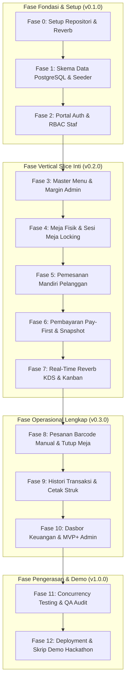

# Roadmap & Rencana Implementasi Bertahap (PLAN.md) — MICRODINE

> **Inovasi Platform Manajemen Restoran Terpadu untuk Mendorong Kemandirian Digital Bisnis Mikro Indonesia**  
> **Versi Dokumen**: 1.0 (Master Execution Plan)  
> **Aturan Eksekusi**: 1 Task = 1 Branch (`feat/T-0xx-...` atau `chore/T-0xx-...`) = 1 Pull Request.  
> **Prinsip Utama**: Prioritaskan *Vertical Slice* Inti (*Scan QR → Order → Pay-First → Real-time Kitchen Queue*), baru kemudian dashboard analitik dan fitur MVP+.

---

## 1. Ikhtisar Pembagian Fase & Git Checkpoint

Pengembangan dibagi ke dalam **13 fase terstruktur (Fase 0 s.d Fase 12)** dengan total **57 task modular** (berbobot 1–2 jam per task):



---

## 2. Rincian Task per Fase

---

### FASE 0: Setup Lingkungan, Reverb, Tailwind Dual-Theme, & Layout Shells

> **Tujuan**: Menyiapkan kerangka kerja monolitik Laravel 11, React 18 via Inertia.js v2, server WebSockets Laravel Reverb, sistem token Tailwind CSS dual-theme (`theatre` & `ocean`), serta GitHub Actions CI.

#### [T-001] Inisialisasi Laravel 11 Monolitik + React 18 + Inertia.js v2 + Vite
- **Deskripsi**: Melakukan instalasi Laravel 11.x dan mengonfigurasi adapter Inertia.js v2 beserta React 18, React DOM, dan Vite.
- **Area / File**: `composer.json`, `package.json`, `vite.config.js`, `resources/views/app.blade.php`, `resources/js/app.jsx`.
- **Dependensi**: Tidak ada.
- **Acceptance Criteria**: Halaman awal berhasil merender komponen React via Inertia tanpa error konsol.
- **Test**: `tests/Feature/ExampleTest.php` memastikan rute `/` mengembalikan status HTTP 200.
- **Referensi**: ARCHITECTURE.md Bab 2.
- **Branch**: `chore/T-001-setup-laravel-inertia-react`
- **Commit / PR**: `chore(T-001): initialize laravel 11 with inertia v2 and react 18`

#### [T-002] Konfigurasi Tailwind CSS & Dual-Theme Tokens (`theatre` & `ocean`)
- **Deskripsi**: Mengonfigurasi `tailwind.config.js` dan variabel CSS di `resources/css/app.css` sesuai spesifikasi `DESIGN.md`.
- **Area / File**: `tailwind.config.js`, `resources/css/app.css`, font Plus Jakarta Sans di `app.blade.php`.
- **Dependensi**: `T-001`.
- **Acceptance Criteria**: Utilitas Tailwind dapat membaca token `--color-bg`, `--color-primary`, dll., dan merespons pergantian atribut `data-theme`.
- **Test**: Uji visual rendering tombol emas dengan teks obsidian (rasio kontras 7.2:1).
- **Referensi**: DESIGN.md Bab 2.
- **Branch**: `chore/T-002-configure-tailwind-dual-theme`
- **Commit / PR**: `chore(T-002): configure tailwind css with theatre and ocean design tokens`

#### [T-003] Instalasi & Konfigurasi Laravel Reverb WebSockets + Laravel Echo
- **Deskripsi**: Menginstal `laravel/reverb`, menerbitkan konfigurasi reverb, dan membuat `resources/js/Echo.js`.
- **Area / File**: `config/reverb.php`, `resources/js/Echo.js`, `.env.example`.
- **Dependensi**: `T-001`.
- **Acceptance Criteria**: Perintah `php artisan reverb:start` berjalan di port 8080 dan Laravel Echo di frontend dapat terhubung.
- **Test**: Verifikasi jabat tangan koneksi soket Reverb pada log browser.
- **Referensi**: ARCHITECTURE.md Bab 6.
- **Branch**: `chore/T-003-install-laravel-reverb-echo`
- **Commit / PR**: `chore(T-003): setup laravel reverb websockets and echo client`

#### [T-004] Pembuatan Struktur Layout Shells
- **Deskripsi**: Membangun 3 layout shell: `CustomerLayout.jsx` (mobile-first 390px, header navy), `StaffLayout.jsx` (sidebar 260px gelap), dan `KitchenLayout.jsx` (layar penuh KDS).
- **Area / File**: `resources/js/Layouts/CustomerLayout.jsx`, `StaffLayout.jsx`, `KitchenLayout.jsx`.
- **Dependensi**: `T-002`.
- **Acceptance Criteria**: Masing-masing layout merender children, responsive, dan memiliki penampung status koneksi.
- **Test**: Manual visual check responsiveness pada viewport 390px dan 1280px.
- **Referensi**: DESIGN.md Bab 3.
- **Branch**: `feat/T-004-create-layout-shells`
- **Commit / PR**: `feat(T-004): create customer, staff, and kitchen layout shells`

#### [T-005] Setup Linter (Laravel Pint + ESLint) & GitHub Actions CI Workflow
- **Deskripsi**: Menambahkan konfigurasi linting otomatis PHP dan JS serta file workflow `.github/workflows/ci.yml`.
- **Area / File**: `.github/workflows/ci.yml`, `pint.json`, `.eslintrc.json`.
- **Dependensi**: `T-001`.
- **Acceptance Criteria**: Eksekusi `./vendor/bin/pint --test` dan `npm run lint` berjalan tanpa error; GitHub Actions lulus pada pull request.
- **Test**: Menjalankan linting dan unit test dummy di pipeline CI.
- **Referensi**: AGENTS.md Bab 4 & 11.
- **Branch**: `chore/T-005-setup-linting-and-ci`
- **Commit / PR**: `chore(T-005): configure pint, eslint, and github actions ci pipeline`

---

### FASE 1: Fondasi Skema Data, Enums, & Seeder

> **Tujuan**: Membangun 11 tabel PostgreSQL relasional lengkap dengan *partial unique index*, nilai moneter integer Rupiah (`bigint`), enums, model Eloquent, dan seeder transaksi historis 14 hari.

#### [T-006] Migrasi Database: Tabel Pengguna, Pengaturan, Kategori, & Master Menu
- **Deskripsi**: Menulis migration untuk tabel `users`, `restaurant_settings`, `categories`, dan `menu_items`.
- **Area / File**: `database/migrations/*_create_users_settings_categories_menu_items_table.php`.
- **Dependensi**: `T-001`.
- **Acceptance Criteria**: Kolom `price` dan `hpp` bertipe `bigint`, soft deletes pada `menu_items`, `php artisan migrate` berjalan sukses.
- **Test**: `tests/Feature/DatabaseMigrationTest.php` memverifikasi struktur tabel dan kolom.
- **Referensi**: ARCHITECTURE.md Bab 3.2 (Tabel 1–4).
- **Branch**: `feat/T-006-migration-users-menu-settings`
- **Commit / PR**: `feat(T-006): create migrations for users, settings, categories, and menu_items`

#### [T-007] Migrasi Database: Meja Fisik & Sesi Meja (Partial Unique Index)
- **Deskripsi**: Menulis migration untuk `dining_tables` dan `table_sessions` dengan partial unique index PostgreSQL `WHERE status = 'active'`.
- **Area / File**: `database/migrations/*_create_dining_tables_and_sessions_table.php`.
- **Dependensi**: `T-006`.
- **Acceptance Criteria**: PostgreSQL mencegah pembuatan dua baris dengan `dining_table_id` sama yang keduanya berstatus `active`.
- **Test**: Unit test mencoba insert dua sesi aktif pada meja yang sama dan memverifikasi terjadinya `QueryException`.
- **Referensi**: ARCHITECTURE.md Bab 3.2 (Tabel 5–6).
- **Branch**: `feat/T-007-migration-tables-and-sessions`
- **Commit / PR**: `feat(T-007): create migrations for dining_tables and table_sessions with partial index`

#### [T-008] Migrasi Database: Pesanan, Item Snapshot, Pembayaran, Log, & Target
- **Deskripsi**: Menulis migration untuk `orders`, `order_items` (`unit_price_snapshot`, `unit_hpp_snapshot`), `payments`, `order_status_logs`, dan `sales_targets`.
- **Area / File**: `database/migrations/*_create_orders_payments_logs_targets_table.php`.
- **Dependensi**: `T-007`.
- **Acceptance Criteria**: Seluruh kolom uang bertipe `bigint`, indeks pelaporan `(payment_status, paid_at)` terbentuk sempurna.
- **Test**: `php artisan migrate:fresh` berhasil tanpa error relasi foreign key.
- **Referensi**: ARCHITECTURE.md Bab 3.2 (Tabel 7–11).
- **Branch**: `feat/T-008-migration-orders-payments-logs`
- **Commit / PR**: `feat(T-008): create migrations for orders, order_items snapshot, payments, and logs`

#### [T-009] Implementasi PHP 8.2 Backed Enums
- **Deskripsi**: Membuat file Enum backed string untuk `UserRole`, `PaymentStatus`, `KitchenStatus`, `TableSessionStatus`, `PaymentMethod`, dan `OrderSource`.
- **Area / File**: `app/Enums/*.php`.
- **Dependensi**: `T-008`.
- **Acceptance Criteria**: Seluruh status terdefinisi dengan method label bahasa Indonesia untuk tampilan UI.
- **Test**: Unit test memvalidasi nilai enum dan casting.
- **Referensi**: ARCHITECTURE.md Bab 2 & 4.
- **Branch**: `feat/T-009-create-php-enums`
- **Commit / PR**: `feat(T-009): implement php 8.2 backed enums for domain statuses`

#### [T-010] Model Eloquent dengan Strict Typing, Casts, Relasi, & Scopes
- **Deskripsi**: Membuat seluruh model Eloquent (`User`, `RestaurantSetting`, `Category`, `MenuItem`, `DiningTable`, `TableSession`, `Order`, `OrderItem`, `Payment`, `OrderStatusLog`, `SalesTarget`).
- **Area / File**: `app/Models/*.php`.
- **Dependensi**: `T-009`.
- **Acceptance Criteria**: Relasi `hasMany`, `belongsTo` berfungsi dua arah; casting enum dan integer aktif.
- **Test**: Unit test memvalidasi relasi antar model.
- **Referensi**: ARCHITECTURE.md Bab 3.
- **Branch**: `feat/T-010-create-eloquent-models`
- **Commit / PR**: `feat(T-010): implement eloquent models with strict typing and relationships`

#### [T-011] Model Factories & Database Seeder Komprehensif
- **Deskripsi**: Membuat factory dan `DatabaseSeeder` yang mengisi 12 meja fisik (Area Dalam & Teras), 15 menu makanan/minuman, akun staf default, dan histori transaksi 14 hari terakhir.
- **Area / File**: `database/factories/*`, `database/seeders/DatabaseSeeder.php`.
- **Dependensi**: `T-010`.
- **Acceptance Criteria**: Perintah `php artisan migrate:fresh --seed` menghasilkan data realistis untuk pengujian langsung.
- **Test**: Feature test memeriksa bahwa terdapat >= 10 meja dan transaksi historis dengan status `paid`.
- **Referensi**: ARCHITECTURE.md Bab 11.2.
- **Branch**: `feat/T-011-database-seeders-demo`
- **Commit / PR**: `feat(T-011): create factories and comprehensive 14-day demo database seeder`

---

### FASE 2: Portal Autentikasi Staf & Kontrol Akses RBAC

> **Tujuan**: Membangun portal login terpusat dengan tab Kasir/Admin, proteksi rute staf via middleware, dan redirect sesuai peran.  
> **Git Checkpoint**: `v0.1.0` (Fondasi Repositori, Database, & Auth Selesai).

#### [T-012] Controller & Logika Autentikasi Staf
- **Deskripsi**: Mengembangkan `AuthenticatedSessionController` untuk menangani otentikasi login, regenerasi session, dan logout.
- **Area / File**: `app/Http/Controllers/Auth/AuthenticatedSessionController.php`, `app/Http/Requests/Auth/LoginRequest.php`.
- **Dependensi**: `T-010`.
- **Acceptance Criteria**: Percobaan login tervalidasi dengan rate limiting 5 kali/menit; password diverifikasi aman.
- **Test**: `tests/Feature/Auth/AuthenticationTest.php` (login sukses kasir, login sukses admin, login gagal).
- **Referensi**: PRD.md [FR-06].
- **Branch**: `feat/T-012-auth-session-controller`
- **Commit / PR**: `feat(T-012): implement authenticated session controller with rate limiting`

#### [T-013] Antarmuka Portal Login Karyawan Terpusat
- **Deskripsi**: Membangun tampilan login sesuai Layar 2 mockup dengan latar belakang foto restoran redup, tab "Kasir" vs "Admin", input username & password.
- **Area / File**: `resources/js/Pages/Auth/Login.jsx`.
- **Dependensi**: `T-004`, `T-012`.
- **Acceptance Criteria**: Tampilan 100% konsisten dengan Mockup Layar 2; tab berpindah aktif; menampilkan pesan error validasi.
- **Test**: Manual UI test pada desktop dan tablet.
- **Referensi**: PRD.md [FR-06], Mockup Layar 2, DESIGN.md Bab 5.
- **Branch**: `feat/T-013-login-ui-component`
- **Commit / PR**: `feat(T-013): build central employee portal login screen matching mockup 2`

#### [T-014] Middleware RBAC (`EnsureUserRole`) & Penanganan Redirect
- **Deskripsi**: Membuat middleware `EnsureUserRole` yang memastikan kasir hanya dapat mengakses `/cashier/*`, admin ke `/admin/*`, dan dapur ke `/kitchen/*`.
- **Area / File**: `app/Http/Middleware/EnsureUserRole.php`, `bootstrap/app.php`.
- **Dependensi**: `T-012`.
- **Acceptance Criteria**: Pengguna tanpa izin mendapatkan respon HTTP 403 atau dialihkan ke dasbor perannya.
- **Test**: `tests/Feature/Auth/RoleAccessTest.php` menguji proteksi rute tiap peran.
- **Referensi**: AGENTS.md Bab 6.
- **Branch**: `feat/T-014-rbac-role-middleware`
- **Commit / PR**: `feat(T-014): implement role-based access control middleware and redirects`

> **GIT CHECKPOINT: TAG `v0.1.0`**  
> Seluruh PR Fase 0, 1, dan 2 telah di-merge ke `main`. Jalankan `git tag -a v0.1.0 -m "Release v0.1.0: Foundation, Schema, and Staff Auth"` dan push tag ke remote origin.

---

### FASE 3: Manajemen Master Menu & Kalkulator Margin Admin

> **Tujuan**: Admin dapat mengelola menu (CRUD), menghitung margin laba secara real-time di modal, serta mengubah status ketersediaan.

#### [T-015] Controller & FormRequest Validasi Menu Admin
- **Deskripsi**: Membuat `MenuManagementController` dengan aksi `index`, `store`, `update`, `destroy`, dan `toggleAvailability`.
- **Area / File**: `app/Http/Controllers/Admin/MenuManagementController.php`, `app/Http/Requests/Admin/MenuItemRequest.php`.
- **Dependensi**: `T-014`.
- **Acceptance Criteria**: Validasi harga dan HPP wajib bilangan bulat `>= 0`; gambar diunggah ke storage disk.
- **Test**: `tests/Feature/Admin/MenuItemCrudTest.php`.
- **Referensi**: PRD.md [FR-14].
- **Branch**: `feat/T-015-menu-management-controller`
- **Commit / PR**: `feat(T-015): implement admin menu management controller and requests`

#### [T-016] Halaman Antarmuka Master Menu Admin
- **Deskripsi**: Membangun halaman tabel menu sesuai Mockup Layar 6, menampilkan kategori, HPP, harga jual, margin, dan status ketersediaan.
- **Area / File**: `resources/js/Pages/Admin/Menu.jsx`, `resources/js/Components/Admin/MenuTable.jsx`.
- **Dependensi**: `T-015`.
- **Acceptance Criteria**: Tabel menampilkan seluruh data menu dengan pemisah ribuan rupiah; tombol aksi edit dan hapus berfungsi.
- **Test**: Render test halaman menu admin.
- **Referensi**: PRD.md [FR-14], Mockup Layar 6.
- **Branch**: `feat/T-016-admin-menu-page-ui`
- **Commit / PR**: `feat(T-016): build admin menu master table page matching mockup 6`

#### [T-017] Modal Tambah/Edit Menu dengan Kalkulator Margin Real-Time
- **Deskripsi**: Membangun modal pop-up tambah/edit menu yang otomatis menghitung selisih laba nominal dan persentase margin saat HPP atau Harga Jual diketik.
- **Area / File**: `resources/js/Components/Admin/MenuItemModal.jsx`.
- **Dependensi**: `T-016`.
- **Acceptance Criteria**: Memasukkan HPP Rp 4.000 dan Harga Jual Rp 12.000 seketika memunculkan: *"Margin otomatis: Rp 8.000 - 67%"*.
- **Test**: Unit test fungsi kalkulator margin frontend.
- **Referensi**: PRD.md [FR-14], Mockup Layar 6.
- **Branch**: `feat/T-017-menu-modal-margin-calculator`
- **Commit / PR**: `feat(T-017): build menu modal with real-time margin and profit calculation`

#### [T-018] Toggle Instan Ketersediaan Dapur & Visibilitas Katalog Pelanggan
- **Deskripsi**: Fitur switch toggle untuk mengubah status `is_available` dan `show_in_catalog` secara asinkron tanpa reload halaman penuh.
- **Area / File**: `app/Actions/Menus/ToggleMenuStatusAction.php`, `resources/js/Pages/Admin/Menu.jsx`.
- **Dependensi**: `T-017`.
- **Acceptance Criteria**: Mengubah status menu seketika memperbarui database dan memicu toast notifikasi sukses.
- **Test**: Feature test memeriksa perubahan status `is_available` via endpoint PATCH.
- **Referensi**: PRD.md [FR-14].
- **Branch**: `feat/T-018-menu-availability-toggle`
- **Commit / PR**: `feat(T-018): add asynchronous toggle for menu availability and catalog visibility`

---

### FASE 4: Meja Fisik, Token QR, & Resolusi Sesi Meja

> **Tujuan**: Membuat token QR meja yang aman, mengunci sesi meja dengan *pessimistic locking*, dan menyajikan visualisasi grid denah meja kasir.

#### [T-019] Generator Token QR Kriptografis & Barcode Meja Fisik
- **Deskripsi**: Membuat utilitas pembuatan token QR 32 karakter acak CSPRNG (`Str::random(32)`) dan barcode code unik untuk setiap meja fisik.
- **Area / File**: `app/Services/TableSessionService.php`, `database/seeders/DiningTableSeeder.php`.
- **Dependensi**: `T-010`.
- **Acceptance Criteria**: Setiap meja memiliki token QR unik yang tidak berurutan dan tidak dapat ditebak.
- **Test**: Unit test memverifikasi keunikan dan entropi token QR meja.
- **Referensi**: ARCHITECTURE.md Bab 10.
- **Branch**: `feat/T-019-qr-token-generator`
- **Commit / PR**: `feat(T-019): implement cryptographically secure qr token generator for tables`

#### [T-020] Service Resolusi Sesi Meja dengan Pessimistic Row Locking
- **Deskripsi**: Mengembangkan `resolveActiveSession()` pada `TableSessionService` dengan `SELECT FOR UPDATE` untuk mencegah race condition.
- **Area / File**: `app/Services/TableSessionService.php`, `app/Actions/Tables/InitializeTableSessionAction.php`.
- **Dependensi**: `T-019`.
- **Acceptance Criteria**: Dua permintaan scan bersamaan di meja yang sama menghasilkan 1 sesi aktif yang sama (*join session*).
- **Test**: `tests/Feature/TableSessionLockingTest.php`.
- **Referensi**: AGENTS.md Invarian 4, ARCHITECTURE.md Bab 5(A) & 9.
- **Branch**: `feat/T-020-table-session-locking-service`
- **Commit / PR**: `feat(T-020): implement table session service with pessimistic row locking`

#### [T-021] Halaman Grid Manajemen Meja Kasir
- **Deskripsi**: Membangun tampilan grid denah meja sesuai Mockup Layar 4, menampilkan status hijau (Tersedia) dan merah (Terisi) beserta waktu duduk.
- **Area / File**: `app/Http/Controllers/Cashier/TableManagementController.php`, `resources/js/Pages/Cashier/Tables.jsx`.
- **Dependensi**: `T-020`.
- **Acceptance Criteria**: Tampilan 100% konsisten dengan Mockup Layar 4; kartu meja menampilkan durasi sesi aktif berjalan.
- **Test**: Feature test memeriksa rute `/cashier/tables` mengembalikan koleksi meja dan sesi.
- **Referensi**: PRD.md [FR-10], Mockup Layar 4.
- **Branch**: `feat/T-021-cashier-table-grid-ui`
- **Commit / PR**: `feat(T-021): build cashier table management grid matching mockup 4`

#### [T-022] Modal Pratinjau & Unduh Stiker Lembar QR Code Meja
- **Deskripsi**: Menambahkan modal pada kasir/admin untuk melihat QR code meja dan mengunduh format siap cetak untuk ditempel di meja fisik.
- **Area / File**: `resources/js/Components/Cashier/TableQrModal.jsx`.
- **Dependensi**: `T-021`.
- **Acceptance Criteria**: QR code dapat dipindai oleh kamera gawai dan mengarah ke URL `/table/{qr_token}`.
- **Test**: Manual scan QR test menggunakan smartphone.
- **Referensi**: PRD.md [FR-16].
- **Branch**: `feat/T-022-table-qr-download-modal`
- **Commit / PR**: `feat(T-022): implement table qr code preview and download modal`

---

### FASE 5: Antarmuka Pemesanan Mandiri Pelanggan (Customer Mobile-First)

> **Tujuan**: Pelanggan memindai QR meja, melihat katalog responsif, menyusun keranjang dengan catatan kustom, memilih pembayaran di checkout, dan melacak status pesanan.

#### [T-023] Halaman Katalog Menu Digital Pelanggan & Filter Kategori
- **Deskripsi**: Membangun antarmuka katalog mobile-first sesuai Mockup Layar 1 dengan header navy penampil nomor meja terkunci, filter kategori chip, dan pencarian.
- **Area / File**: `app/Http/Controllers/Customer/MenuCatalogController.php`, `resources/js/Pages/Customer/Menu.jsx`.
- **Dependensi**: `T-020`.
- **Acceptance Criteria**: Mengakses `/table/{valid_token}` mengunci nomor meja di header; filter kategori dan pencarian berjalan instan.
- **Test**: `tests/Feature/Customer/MenuCatalogTest.php`.
- **Referensi**: PRD.md [FR-01, FR-02], Mockup Layar 1.
- **Branch**: `feat/T-023-customer-menu-catalog`
- **Commit / PR**: `feat(T-023): build customer mobile-first menu catalog page matching mockup 1`

#### [T-024] Halaman Keranjang Belanja Pelanggan & Catatan Kustom per Item
- **Deskripsi**: Membangun keranjang pesanan dengan kontrol kuantitas (+/-), input catatan masakan per item ("Tanpa bawang goreng"), subtotal, dan pajak PBJT/PB1 10%.
- **Area / File**: `resources/js/Pages/Customer/Cart.jsx`, `resources/js/Components/Customer/OrderItemCard.jsx`.
- **Dependensi**: `T-023`.
- **Acceptance Criteria**: Perubahan porsi memperbarui subtotal dan pajak secara akurat dalam integer rupiah.
- **Test**: Unit test kalkulasi subtotal dan pajak di keranjang.
- **Referensi**: PRD.md [FR-03], Mockup Layar 1.
- **Branch**: `feat/T-024-customer-cart-page`
- **Commit / PR**: `feat(T-024): implement customer cart page with item notes and tax breakdown`

#### [T-025] Formulir Checkout Pelanggan & Input Nama Pemesan
- **Deskripsi**: Membangun halaman checkout untuk memasukkan nama pemesan dan memilih metode pembayaran (**QRIS** atau **Tunai di Kasir**).
- **Area / File**: `app/Http/Controllers/Customer/CheckoutController.php`, `resources/js/Pages/Customer/Checkout.jsx`.
- **Dependensi**: `T-024`.
- **Acceptance Criteria**: Menekan "Konfirmasi Pesanan" memvalidasi ketersediaan menu di database dan membuat pesanan berstatus `pending`.
- **Test**: `tests/Feature/Customer/CheckoutTest.php`.
- **Referensi**: PRD.md [FR-04], Mockup Layar 1.
- **Branch**: `feat/T-025-customer-checkout-form`
- **Commit / PR**: `feat(T-025): build customer checkout form with payment method selection`

#### [T-026] Halaman Pelacak Status Pesanan Pelanggan
- **Deskripsi**: Membangun tampilan pelacak status pesanan sesuai Mockup Layar 1 dengan nomor antrean (misal: `A-024`), indikator 3 tahap (*Menunggu Bayar → Sedang Dimasak → Siap Disajikan*), dan tombol "Pesan Menu Lagi".
- **Area / File**: `app/Http/Controllers/Customer/OrderTrackingController.php`, `resources/js/Pages/Customer/OrderStatus.jsx`.
- **Dependensi**: `T-025`.
- **Acceptance Criteria**: Menampilkan rincian pesanan dan status terkini secara akurat.
- **Test**: Feature test memeriksa halaman status hanya dapat diakses dengan token pesanan yang valid.
- **Referensi**: PRD.md [FR-05], Mockup Layar 1.
- **Branch**: `feat/T-026-customer-order-status-page`
- **Commit / PR**: `feat(T-026): build customer order status tracking page matching mockup 1`

---

### FASE 6: Modul Pembayaran Pay-First & Snapshot Finansial

> **Tujuan**: Mengimplementasikan alur pembayaran tunai (modal kasir) dan digital QRIS (Midtrans sandbox & simulator demo), memvalidasi signature & idempotensi webhook, serta mengunci snapshot HPP statis pada transaksi.

#### [T-027] Abstraksi `PaymentGatewayInterface` & Implementasi `SimulatedPaymentGateway`
- **Deskripsi**: Membuat interface kontrak gateway pembayaran dan driver simulator untuk kebutuhan demo hackathon offline.
- **Area / File**: `app/Services/Gateways/PaymentGatewayInterface.php`, `SimulatedPaymentGateway.php`.
- **Dependensi**: `T-025`.
- **Acceptance Criteria**: Driver simulator mampu menghasilkan string QR dummy dan memvalidasi pembayaran instan.
- **Test**: Unit test kontrak interface gateway.
- **Referensi**: ARCHITECTURE.md Bab 8.
- **Branch**: `feat/T-027-payment-gateway-abstraction`
- **Commit / PR**: `feat(T-027): implement payment gateway interface and simulated driver for demo`

#### [T-028] Implementasi `MidtransPaymentGateway` (Sandbox QRIS)
- **Deskripsi**: Mengintegrasikan API Midtrans Snap/Core API untuk menerbitkan QRIS dinamis dan memverifikasi tanda tangan kriptografis SHA-512.
- **Area / File**: `app/Services/Gateways/MidtransPaymentGateway.php`.
- **Dependensi**: `T-027`.
- **Acceptance Criteria**: Pemanggilan API menghasilkan QRIS payload valid; rumus SHA-512 memverifikasi keaslian webhook.
- **Test**: Unit test verifikasi rumus hash SHA-512.
- **Referensi**: ARCHITECTURE.md Bab 8.
- **Branch**: `feat/T-028-midtrans-qris-integration`
- **Commit / PR**: `feat(T-028): implement midtrans payment gateway driver with sha512 verification`

#### [T-029] Controller Webhook Gateway Idempoten & Penanganan Expired 15 Menit
- **Deskripsi**: Mengembangkan `MidtransWebhookController` yang menangani notifikasi pelunasan secara idempoten dan menangani pesanan kedaluwarsa.
- **Area / File**: `app/Http/Controllers/Webhooks/MidtransWebhookController.php`.
- **Dependensi**: `T-028`.
- **Acceptance Criteria**: Webhook duplikat tidak memicu penulisan omzet ganda (idempotency key); pesanan beralih ke `paid` saat signature valid.
- **Test**: `tests/Feature/WebhookIdempotencyTest.php`.
- **Referensi**: AGENTS.md Invarian 8, PRD.md [FR-04, Kasus Tepi 2-3].
- **Branch**: `feat/T-029-idempotent-webhook-controller`
- **Commit / PR**: `feat(T-029): implement idempotent payment webhook controller with expiration handling`

#### [T-030] Action & Controller Pembayaran Tunai Kasir
- **Deskripsi**: Mengembangkan `ProcessCashPaymentAction` yang memvalidasi uang tunai diterima dan memperbarui status pesanan menjadi `paid`.
- **Area / File**: `app/Actions/Orders/ProcessCashPaymentAction.php`, `app/Http/Controllers/Cashier/KanbanOrderController.php`.
- **Dependensi**: `T-010`.
- **Acceptance Criteria**: Status pesanan berubah menjadi `paid` dan waktu `paid_at` tercatat saat kasir mengonfirmasi.
- **Test**: `tests/Feature/Cashier/CashPaymentTest.php`.
- **Referensi**: PRD.md [FR-08].
- **Branch**: `feat/T-030-cash-payment-action`
- **Commit / PR**: `feat(T-030): implement process cash payment action for cashier`

#### [T-031] Komponen Pop-up Modal Kalkulator Tunai Kasir
- **Deskripsi**: Membangun komponen modal kalkulator tunai sesuai Mockup Layar 3 yang menghitung kembalian secara otomatis saat kasir mengetik nominal uang diterima.
- **Area / File**: `resources/js/Components/Cashier/CashCalculatorModal.jsx`.
- **Dependensi**: `T-030`.
- **Acceptance Criteria**: Input uang Rp 100.000 untuk tagihan Rp 63.800 otomatis menampilkan kembalian Rp 36.200 dengan warna hijau jelas; tombol konfirmasi aktif jika uang cukup.
- **Test**: Unit test kalkulasi kembalian di modal.
- **Referensi**: PRD.md [FR-08], Mockup Layar 3.
- **Branch**: `feat/T-031-cash-calculator-modal-ui`
- **Commit / PR**: `feat(T-031): build cash calculator modal with automatic change calculation`

#### [T-032] Enforce Perekaman Snapshot HPP Statis & Harga Jual Permanen
- **Deskripsi**: Menjamin pada `CreateOrderAction` bahwa `unit_price_snapshot` dan `unit_hpp_snapshot` diambil langsung dari nilai master menu saat itu dan tidak akan pernah diubah.
- **Area / File**: `app/Actions/Orders/CreateOrderAction.php`.
- **Dependensi**: `T-025`.
- **Acceptance Criteria**: Mengubah harga menu di masa depan tidak mempengaruhi data `unit_hpp_snapshot` dan laba transaksi lama.
- **Test**: `tests/Feature/HppSnapshotTest.php`.
- **Referensi**: AGENTS.md Invarian 2 & 6, ARCHITECTURE.md Bab 3.2 (Tabel 8).
- **Branch**: `feat/T-032-enforce-hpp-snapshot`
- **Commit / PR**: `feat(T-032): enforce immutable unit_price and unit_hpp snapshots on order items`

---

### FASE 7: Sinkronisasi Antrean Real-Time (Reverb WebSockets) — Vertical Slice Selesai!

> **Tujuan**: Menghubungkan alur pesanan dari status `paid` langsung ke KDS dapur dan Kanban kasir seketika via WebSockets tanpa refresh, serta pelacak pelanggan.  
> **Git Checkpoint**: `v0.2.0` (Core Vertical Slice Selesai & Terintegrasi).

#### [T-033] Definisi Event Siaran Instan (ShouldBroadcastNow)
- **Deskripsi**: Membuat kelas event `OrderPaidEvent`, `KitchenStatusUpdatedEvent`, dan `TableSessionUpdatedEvent` yang dipancarkan via `DB::afterCommit()`.
- **Area / File**: `app/Events/OrderPaidEvent.php`, `KitchenStatusUpdatedEvent.php`, `TableSessionUpdatedEvent.php`, `routes/channels.php`.
- **Dependensi**: `T-003`, `T-029`, `T-030`.
- **Acceptance Criteria**: Event terkirim ke saluran Reverb yang tepat segera setelah transaksi database di-commit.
- **Test**: `tests/Feature/RealTimeEventBroadcastTest.php`.
- **Referensi**: AGENTS.md Invarian 5, ARCHITECTURE.md Bab 6.
- **Branch**: `feat/T-033-realtime-broadcast-events`
- **Commit / PR**: `feat(T-033): implement ShouldBroadcastNow events dispatched after database commit`

#### [T-034] Papan Antrean Kanban Kasir Real-Time
- **Deskripsi**: Membangun halaman antrean kasir sesuai Mockup Layar 3 dengan 3 kolom status (*Menunggu Pembayaran*, *Diproses*, *Selesai*) dan 4 kartu ringkasan harian.
- **Area / File**: `resources/js/Pages/Cashier/Orders.jsx`, `resources/js/Components/Cashier/KanbanCard.jsx`.
- **Dependensi**: `T-031`, `T-033`.
- **Acceptance Criteria**: Kartu pesanan baru berpindah kolom seketika saat event Reverb diterima tanpa refresh halaman.
- **Test**: Feature test memeriksa data antrean pesanan pada rute `/cashier/orders`.
- **Referensi**: PRD.md [FR-07], Mockup Layar 3.
- **Branch**: `feat/T-034-cashier-kanban-board`
- **Commit / PR**: `feat(T-034): build real-time cashier kanban order queue matching mockup 3`

#### [T-035] Layar Kitchen Display System (KDS) Dapur
- **Deskripsi**: Membangun layar monitor dapur sesuai Mockup Layar 8 dengan kartu pesanan besar, info porsi/catatan, slot "Kosong", dan toggle progres masakan (*Sedang Dimasak → Selesai*).
- **Area / File**: `app/Http/Controllers/Kitchen/KitchenDisplayController.php`, `resources/js/Pages/Kitchen/Display.jsx`, `resources/js/Components/Kitchen/KDSTicketCard.jsx`.
- **Dependensi**: `T-033`.
- **Acceptance Criteria**: HANYA pesanan berstatus `paid` yang muncul di KDS; menekan tombol selesai memperbarui status pesanan seketika.
- **Test**: `tests/Feature/PayFirstOrderTest.php`.
- **Referensi**: AGENTS.md Invarian 1, PRD.md [FR-12], Mockup Layar 8.
- **Branch**: `feat/T-035-kitchen-display-system`
- **Commit / PR**: `feat(T-035): build real-time kitchen display system (KDS) matching mockup 8`

#### [T-036] Listener Echo di Pelacak Pelanggan & Mekanisme Fallback Polling 5 Detik
- **Deskripsi**: Menghubungkan halaman pelacak pelanggan (`OrderStatus.jsx`) ke saluran privat pesanan dan menyematkan logika fallback polling jika soket terputus.
- **Area / File**: `resources/js/Pages/Customer/OrderStatus.jsx`.
- **Dependensi**: `T-026`, `T-033`.
- **Acceptance Criteria**: Badge status pelanggan otomatis berubah saat koki selesai memasak; jika Reverb disconnect, polling aktif otomatis.
- **Test**: Browser test simulasi perubahan status secara real-time.
- **Referensi**: PRD.md [FR-05, Kasus Tepi 6], ARCHITECTURE.md Bab 6.3.
- **Branch**: `feat/T-036-customer-order-tracker-realtime`
- **Commit / PR**: `feat(T-036): connect customer tracking to reverb with 5-second polling fallback`

> **GIT CHECKPOINT: TAG `v0.2.0` (CORE VERTICAL SLICE)**  
> Alur utama *Scan QR Meja → Pilih Menu → Pay-First (Tunai/QRIS) → KDS Dapur & Kanban Kasir Real-Time* selesai secara utuh! Merge seluruh PR ke `main`, tag `v0.2.0`, dan lakukan demonstrasi alur inti.

---

### FASE 8: Pesanan Manual Kasir, Penutupan Sesi, & Pembatalan

> **Tujuan**: Kasir dapat melayani pesanan manual via barcode scanner fisik meja, membatalkan pesanan pending, dan menutup sesi meja.

#### [T-037] Input Pesanan Manual Kasir via Hardware Barcode Scanner Meja
- **Deskripsi**: Membangun modul pesanan manual di kasir yang otomatis mengunci nomor meja saat hardware barcode scanner memindai barcode meja fisik.
- **Area / File**: `app/Actions/Orders/CreateManualOrderAction.php`, `resources/js/Components/Cashier/ManualOrderModal.jsx`.
- **Dependensi**: `T-034`.
- **Acceptance Criteria**: Memindai barcode meja mengunci sesi meja terkait; pembayaran tunai langsung mengubah status menjadi `paid` dan masuk KDS.
- **Test**: Feature test pembuatan pesanan manual kasir.
- **Referensi**: PRD.md [FR-09], ARCHITECTURE.md Bab 5(D).
- **Branch**: `feat/T-037-cashier-manual-barcode-order`
- **Commit / PR**: `feat(T-037): implement manual order processing via physical table barcode scanner`

#### [T-038] Aksi Penutupan Sesi Meja (`CloseTableSessionAction`) & Dialog Konfirmasi Pengaman
- **Deskripsi**: Mengembangkan logika penutupan sesi meja yang memeriksa apakah masih ada masakan yang belum disajikan sebelum meja ditutup.
- **Area / File**: `app/Actions/Tables/CloseTableSessionAction.php`, `resources/js/Pages/Cashier/Tables.jsx`.
- **Dependensi**: `T-021`, `T-034`.
- **Acceptance Criteria**: Menutup sesi mengubah status meja menjadi hijau "Tersedia"; jika masih ada masakan belum selesai, dialog konfirmasi peringatan muncul.
- **Test**: `tests/Feature/TableSessionClosureTest.php`.
- **Referensi**: PRD.md [FR-10, Kasus Tepi 7], ARCHITECTURE.md Bab 5(F).
- **Branch**: `feat/T-038-close-table-session-action`
- **Commit / PR**: `feat(T-038): implement table session closure with unserved order guard dialog`

#### [T-039] Fitur Pembatalan Pesanan Belum Bayar oleh Kasir & Pelepasan Sesi Meja
- **Deskripsi**: Aksi kasir untuk membatalkan pesanan berstatus `pending` (tunai yang tidak dilunasi) dan membebaskan meja jika tidak ada pesanan lain.
- **Area / File**: `app/Actions/Orders/CancelOrderAction.php`, `resources/js/Pages/Cashier/Orders.jsx`.
- **Dependensi**: `T-034`.
- **Acceptance Criteria**: Status pesanan berubah menjadi `cancelled`, kartu terhapus dari Kanban, dan pesanan dikecualikan dari omzet.
- **Test**: Feature test pembatalan pesanan kasir.
- **Referensi**: PRD.md [FR-07, Kasus Tepi 4].
- **Branch**: `feat/T-039-cashier-cancel-pending-order`
- **Commit / PR**: `feat(T-039): implement order cancellation for pending cash orders by cashier`

---

### FASE 9: Histori Transaksi Kasir & Cetak Ulang Struk

> **Tujuan**: Kasir dapat meninjau riwayat transaksi harian, mengaudit jejak webhook pembayaran, dan mencetak ulang struk thermal.

#### [T-040] Halaman Histori Pesanan Kasir dengan Multi-Filter
- **Deskripsi**: Membangun tampilan histori transaksi kasir sesuai Mockup Layar 4 dengan filter rentang tanggal, filter metode bayar, dan tab status.
- **Area / File**: `app/Http/Controllers/Cashier/TransactionHistoryController.php`, `resources/js/Pages/Cashier/History.jsx`.
- **Dependensi**: `T-034`.
- **Acceptance Criteria**: Tabel menyajikan riwayat transaksi terfilter dengan pagination; status lunas/batal/gagal ber-badge rapi.
- **Test**: Feature test query histori transaksi dengan filter.
- **Referensi**: PRD.md [FR-11], Mockup Layar 4.
- **Branch**: `feat/T-040-cashier-transaction-history-ui`
- **Commit / PR**: `feat(T-040): build cashier daily transaction history page matching mockup 4`

#### [T-041] Panel Drawer Detail Audit Transaksi & Log Status
- **Deskripsi**: Membangun panel samping (*drawer*) yang muncul saat baris transaksi diklik, menampilkan rincian item, jejak waktu perubahan status, dan payload verifikasi webhook.
- **Area / File**: `resources/js/Components/Cashier/OrderDetailDrawer.jsx`.
- **Dependensi**: `T-040`.
- **Acceptance Criteria**: Drawer menampilkan timeline lengkap: waktu pesan dibuat, waktu bayar lunas, verifikasi signature webhook gateway, dan waktu masakan selesai.
- **Test**: Unit test komponen drawer audit.
- **Referensi**: PRD.md [FR-11], Mockup Layar 4.
- **Branch**: `feat/T-041-order-detail-audit-drawer`
- **Commit / PR**: `feat(T-041): implement order detail audit drawer with timeline and webhook status`

#### [T-042] Format Cetak Struk Kasir Thermal CSS 58mm/80mm (`@media print`)
- **Deskripsi**: Membuat komponen struk belanja siap cetak dengan styling `@media print` untuk ukuran printer thermal standar 58mm dan 80mm.
- **Area / File**: `resources/js/Components/Cashier/PrintableReceipt.jsx`, `resources/css/receipt.css`.
- **Dependensi**: `T-041`.
- **Acceptance Criteria**: Menekan "Cetak Ulang Struk" memicu dialog `window.print()` peramban dengan layout struk kasir yang presisi tanpa header/footer default browser.
- **Test**: Manual visual print preview test.
- **Referensi**: PRD.md [FR-11], ARCHITECTURE.md Bab 11.1.
- **Branch**: `feat/T-042-thermal-receipt-printing`
- **Commit / PR**: `feat(T-042): implement thermal receipt printing component for 58mm and 80mm paper`

---

### FASE 10: Dasbor Keuangan Eksekutif & Fitur MVP+ Admin

> **Tujuan**: Admin dapat melihat ringkasan bisnis (omzet, HPP, laba 14 hari), mengekspor audit laporan ke Excel, mengatur pajak PBJT/PB1, mengelola akun kasir, dan memantau target penjualan bulanan.

#### [T-043] Service Agregasi Finansial Laba Rugi Berbasis Snapshot
- **Deskripsi**: Mengembangkan `FinancialReportService` yang menghitung omzet, HPP, laba kotor, dan ranking menu HANYA dari transaksi `payment_status = 'paid'`.
- **Area / File**: `app/Services/FinancialReportService.php`.
- **Dependensi**: `T-032`.
- **Acceptance Criteria**: Pesanan pending, failed, atau cancelled secara mutlak diabaikan dari kalkulasi omzet; kueri memanfaatkan indeks pelaporan.
- **Test**: `tests/Feature/Admin/FinancialCalculationTest.php`.
- **Referensi**: AGENTS.md Invarian 3, PRD.md [FR-13].
- **Branch**: `feat/T-043-financial-report-service`
- **Commit / PR**: `feat(T-043): implement financial report service aggregating only paid transactions`

#### [T-044] Dasbor Ringkasan Bisnis Admin & Grafik Recharts 14 Hari
- **Deskripsi**: Membangun halaman dashboard admin sesuai Mockup Layar 5 dengan 4 kartu metrik utama, grafik batang komparatif omzet vs laba, widget QRIS vs Tunai, dan menu terlaris.
- **Area / File**: `app/Http/Controllers/Admin/DashboardAnalyticsController.php`, `resources/js/Pages/Admin/Dashboard.jsx`, `resources/js/Components/Admin/RevenueLineChart.jsx`.
- **Dependensi**: `T-043`.
- **Acceptance Criteria**: Tampilan 100% konsisten dengan Mockup Layar 5; grafik merender data historis 14 hari dengan tooltip Rupiah.
- **Test**: Feature test memeriksa rute `/admin/dashboard`.
- **Referensi**: PRD.md [FR-13], Mockup Layar 5, DESIGN.md Bab 6.
- **Branch**: `feat/T-044-admin-dashboard-analytics`
- **Commit / PR**: `feat(T-044): build executive business analytics dashboard matching mockup 5`

#### [T-045] Halaman Audit Laporan Transaksi & Ekspor Spreadsheet Excel/CSV
- **Deskripsi**: Membangun halaman audit laporan sesuai Mockup Layar 7 dengan kartu ringkasan, tabel data snapshot historis, serta tombol unduh file spreadsheet (.xlsx/.csv).
- **Area / File**: `app/Http/Controllers/Admin/FinancialReportController.php`, `resources/js/Pages/Admin/Reports.jsx`, `app/Exports/TransactionReportExport.php`.
- **Dependensi**: `T-043`.
- **Acceptance Criteria**: File Excel terunduh dengan data transaksi lunas lengkap beserta rincian HPP dan laba bersih.
- **Test**: Feature test pengunduhan file ekspor laporan.
- **Referensi**: PRD.md [FR-15], Mockup Layar 7.
- **Branch**: `feat/T-045-admin-reports-and-export`
- **Commit / PR**: `feat(T-045): build transaction audit report page with excel and csv export`

#### [T-046] Pengaturan Restoran & Tarif Pajak Daerah PBJT/PB1 (MVP+)
- **Deskripsi**: Membangun halaman pengaturan untuk mengubah nama restoran, alamat, nomor telepon, serta sakelar on/off dan persentase tarif pajak daerah (default 10%).
- **Area / File**: `app/Http/Controllers/Admin/RestaurantSettingsController.php`, `resources/js/Pages/Admin/Settings.jsx`.
- **Dependensi**: `T-014`.
- **Acceptance Criteria**: Mengubah persentase pajak di pengaturan langsung tercermin pada perhitungan pesanan baru di keranjang pelanggan.
- **Test**: Feature test pembaruan pengaturan pajak daerah.
- **Referensi**: AGENTS.md Invarian 7, PRD.md [FR-16].
- **Branch**: `feat/T-046-restaurant-settings-tax`
- **Commit / PR**: `feat(T-046): implement restaurant settings and configurable pbjt/pb1 tax rate`

#### [T-047] Manajemen Akun Staf Kasir (MVP+)
- **Deskripsi**: Membangun antarmuka CRUD akun kasir di panel admin untuk menambah staf kasir, mengatur ulang kata sandi, dan menonaktifkan akun.
- **Area / File**: `app/Http/Controllers/Admin/CashierAccountController.php`, `resources/js/Pages/Admin/Cashiers.jsx`.
- **Dependensi**: `T-014`.
- **Acceptance Criteria**: Kasir baru yang dibuat admin dapat langsung masuk melalui portal login.
- **Test**: Feature test CRUD akun kasir admin.
- **Referensi**: PRD.md [FR-17].
- **Branch**: `feat/T-047-admin-cashier-account-crud`
- **Commit / PR**: `feat(T-047): implement cashier account management module for admin`

#### [T-048] Pemantauan Target Penjualan Bulanan & Kebutuhan Omzet Harian (MVP+)
- **Deskripsi**: Membangun halaman pemantauan target penjualan sesuai Mockup Layar 9 dengan target bulanan, persentase realisasi, sisa target, dan rekomendasi kebutuhan omzet harian.
- **Area / File**: `app/Http/Controllers/Admin/SalesTargetController.php`, `resources/js/Pages/Admin/Targets.jsx`.
- **Dependensi**: `T-043`.
- **Acceptance Criteria**: Memasukkan target Rp 45.000.000 otomatis menghitung sisa target dan membagi dengan sisa hari kalender untuk menghasilkan "Kebutuhan Harian: Rp 1.569.000/hari".
- **Test**: Feature test kalkulasi sisa target dan kebutuhan harian.
- **Referensi**: PRD.md [FR-18], Mockup Layar 9.
- **Branch**: `feat/T-048-sales-targets-and-projections`
- **Commit / PR**: `feat(T-048): build sales target tracking and daily revenue projection matching mockup 9`

> **GIT CHECKPOINT: TAG `v0.3.0` (FEATURE COMPLETE)**  
> Seluruh fitur MVP dan MVP+ telah selesai diimplementasikan secara komprehensif! Merge seluruh PR ke `main` dan beri tag `v0.3.0`.

---

### FASE 11: Pengerasan Sistem, Concurrency Testing, & QA Audit

> **Tujuan**: Menguji ketahanan sistem terhadap race condition, idempotensi webhook, integritas snapshot data finansial, aksesibilitas WCAG AA, dan kepatuhan mockup 100%.

#### [T-049] Automated Concurrency Test (Pest: 2 Scan QR Meja Bersamaan)
- **Deskripsi**: Menulis suite pengujian konkurensi otomatis yang menyimulasikan 10 thread paralel memindai meja yang sama dalam detik yang sama untuk memvalidasi *pessimistic locking*.
- **Area / File**: `tests/Feature/Concurrency/TableSessionConcurrencyTest.php`.
- **Dependensi**: `T-020`.
- **Acceptance Criteria**: Tepat 1 sesi meja aktif yang tercipta; 9 request lainnya bergabung ke sesi aktif yang sama tanpa exception duplikasi.
- **Test**: Eksekusi Pest test konkurensi.
- **Referensi**: AGENTS.md Invarian 4, PRD.md [Kasus Tepi 1].
- **Branch**: `test/T-049-table-concurrency-test`
- **Commit / PR**: `test(T-049): add automated concurrency test for parallel table qr scans`

#### [T-050] Automated Webhook Idempotency & Signature Verification Test
- **Deskripsi**: Menulis pengujian otomatis yang mengirimkan payload webhook Midtrans berulang dengan signature sah dan signature palsu.
- **Area / File**: `tests/Feature/Payments/WebhookSecurityTest.php`.
- **Dependensi**: `T-029`.
- **Acceptance Criteria**: Signature tidak sah ditolak HTTP 403; payload duplikat diterima HTTP 200 tanpa memicu event siaran ganda atau penambahan omzet ganda.
- **Test**: Eksekusi Pest test webhook security.
- **Referensi**: AGENTS.md Invarian 8, PRD.md [Kasus Tepi 3].
- **Branch**: `test/T-050-webhook-idempotency-test`
- **Commit / PR**: `test(T-050): add automated tests for webhook signature validation and idempotency`

#### [T-051] Pengujian Otomatis Integritas Snapshot HPP & Prinsip Pay-First
- **Deskripsi**: Menulis suite pengujian komprehensif yang memvalidasi bahwa transaksi terdahulu tidak mengalami perubahan laba rugi saat harga/HPP menu master diubah di masa depan, dan pesanan pending tidak masuk KDS.
- **Area / File**: `tests/Feature/BusinessRules/InvariantIntegrityTest.php`.
- **Dependensi**: `T-032`, `T-035`, `T-043`.
- **Acceptance Criteria**: 100% konsistensi laba historis dan ketaatan pay-first terbukti secara matematis melalui assertion test.
- **Test**: Eksekusi Pest test aturan invarian.
- **Referensi**: AGENTS.md Bab 5 (Invarian 1 s.d 8).
- **Branch**: `test/T-051-business-invariants-test`
- **Commit / PR**: `test(T-051): add comprehensive test suite for all business invariant rules`

#### [T-052] Audit Aksesibilitas WCAG AA
- **Deskripsi**: Melakukan audit kontras teks otomatis (memastikan teks di atas emas menggunakan Velvet Obsidian 7.2:1), cincin fokus keyboard, dan ukuran sentuh mobile `>= 44px`.
- **Area / File**: `resources/js/**/*.jsx`, `resources/css/app.css`.
- **Dependensi**: Semua task UI.
- **Acceptance Criteria**: Tidak ada elemen kontrol di bawah 44x44px pada tampilan pelanggan; tidak ada teks putih di atas tombol emas.
- **Test**: Audit Lighthouse Accessibility score >= 95.
- **Referensi**: DESIGN.md Bab 2.2 & 8.
- **Branch**: `chore/T-052-a11y-wcag-audit`
- **Commit / PR**: `chore(T-052): audit and enforce wcag aa contrast and touch target standards`

#### [T-053] QA Checklist Kesesuaian 100% terhadap 9 Layar Mockup Proposal
- **Deskripsi**: Verifikasi komparatif satu per satu antara antarmuka aplikasi berjalan dengan 9 gambar tangkapan layar mockup proposal.
- **Area / File**: Dokumentasi verifikasi QA.
- **Dependensi**: Semua task UI.
- **Acceptance Criteria**: Seluruh 10 butir checklist kepatuhan pada `DESIGN.md` Bab 10 tercentang sukses.
- **Test**: Lembar verifikasi QA mockup.
- **Referensi**: DESIGN.md Bab 10.
- **Branch**: `chore/T-053-mockup-compliance-qa`
- **Commit / PR**: `chore(T-053): verify 100% compliance against proposal mockups`

---

### FASE 12: Kesiapan Penerapan & Skenario Demo Hackathon

> **Tujuan**: Menyiapkan tombol dev mode untuk demo offline tanpa internet, panduan skrip demo 5 menit untuk juri, konfigurasi Supervisor produksi, dan dokumentasi instalasi.

#### [T-054] Tombol Dev Mode "Simulasi Pembayaran Berhasil" untuk Demo Offline
- **Deskripsi**: Menambahkan tombol bantuan pengembang rahasia pada halaman status pesanan pelanggan di lingkungan lokal (`APP_ENV=local`) untuk melunasi QRIS secara instan tanpa internet.
- **Area / File**: `resources/js/Pages/Customer/OrderStatus.jsx`, `app/Services/Gateways/SimulatedPaymentGateway.php`.
- **Dependensi**: `T-027`.
- **Acceptance Criteria**: Menekan tombol "Simulasikan Pelunasan QRIS" seketika mengubah status menjadi `paid` dan memancarkan event Reverb ke KDS dapur layaknya pembayaran nyata.
- **Test**: Manual demo simulation test.
- **Referensi**: ARCHITECTURE.md Bab 8.2.
- **Branch**: `feat/T-054-demo-mode-simulation-button`
- **Commit / PR**: `feat(T-054): add dev-mode instant payment simulation button for offline demos`

#### [T-055] Panduan Skrip Skenario Demo End-to-End untuk Penjurian (Durasi 5 Menit)
- **Deskripsi**: Menyusun dokumen panduan skenario demonstrasi langsung (*live demo script*) langkah-demi-langkah bagi tim saat presentasi di hadapan juri.
- **Area / File**: `docs/DEMO_SCRIPT.md`.
- **Dependensi**: `T-054`.
- **Acceptance Criteria**: Alur demonstrasi dapat diselesaikan dalam waktu 4–5 menit membuktikan keunggulan Scan QR → Pay-First → Real-time KDS → Snapshot Laba.
- **Test**: Gladi resik demo end-to-end.
- **Referensi**: PRD.md Bab 8.
- **Branch**: `docs/T-055-hackathon-demo-script`
- **Commit / PR**: `docs(T-055): add 5-minute end-to-end hackathon judging demo script`

#### [T-056] Konfigurasi Deployment Produksi (Nginx, Supervisor Queue & Reverb)
- **Deskripsi**: Menyediakan template konfigurasi server Nginx dan file konfigurasi Supervisor untuk menjalankan queue worker dan Reverb daemon secara persisten.
- **Area / File**: `deploy/nginx/microdine.conf`, `deploy/supervisor/microdine-worker.conf`, `deploy/supervisor/microdine-reverb.conf`.
- **Dependensi**: `T-003`.
- **Acceptance Criteria**: Konfigurasi Supervisor dapat me-restart daemon secara otomatis jika terjadi kegagalan proses (*auto-recovery*).
- **Test**: Validasi sintaks berkas konfigurasi Supervisor.
- **Referensi**: ARCHITECTURE.md Bab 12.2.
- **Branch**: `chore/T-056-production-deployment-configs`
- **Commit / PR**: `chore(T-056): create nginx and supervisor deployment configuration templates`

#### [T-057] Finalisasi Panduan Instalasi Cepat & Dokumentasi Proyek (`README.md`)
- **Deskripsi**: Memperbarui berkas `README.md` utama dengan panduan langkah-demi-langkah setup lokal (`composer install`, `npm install`, setup `.env`, `php artisan migrate --seed`, `php artisan reverb:start`, `npm run dev`).
- **Area / File**: `README.md`.
- **Dependensi**: Semua task sebelumnya.
- **Acceptance Criteria**: Pengembang baru dapat menjalankan seluruh sistem dari nol dalam waktu kurang dari 5 menit mengikuti panduan.
- **Test**: Uji kloning dan setup di lingkungan baru.
- **Referensi**: AGENTS.md Bab 4.
- **Branch**: `docs/T-057-finalize-readme-documentation`
- **Commit / PR**: `docs(T-057): finalize quick-start installation guide and documentation in README`

> **GIT CHECKPOINT: TAG `v1.0.0` (PRODUCTION & HACKATHON READY)**  
> Seluruh 57 task selesai, lulus uji konkurensi dan pengujian invarian, serta siap didemonstrasikan di hadapan dewan juri hackathon. Merge seluruh PR ke `main` dan beri tag rilis resmi `v1.0.0`!

---

## 3. Matriks Keterlacakan (Traceability Matrix: FR → Task → Test)

| Kebutuhan Fungsional (PRD.md) | Task Implementasi (PLAN.md) | Suite Pengujian Otomatis (Pest) |
| :--- | :--- | :--- |
| **FR-01**: Inisiasi Sesi Meja via Scan QR | `T-019`, `T-020`, `T-023` | `TableSessionLockingTest.php` |
| **FR-02**: Katalog Menu & Filter Kategori | `T-023` | `MenuCatalogTest.php` |
| **FR-03**: Keranjang & Catatan Khusus | `T-024` | `CustomerCartTest.php` |
| **FR-04**: Checkout & Pemilihan Pembayaran | `T-025`, `T-028`, `T-030` | `CheckoutTest.php` |
| **FR-05**: Pelacakan Status Real-Time | `T-026`, `T-036` | `OrderStatusTrackingTest.php` |
| **FR-06**: Portal Login Staf Terpusat | `T-012`, `T-013`, `T-014` | `AuthenticationTest.php`, `RoleAccessTest.php` |
| **FR-07**: Antrean Pesanan Kanban Kasir | `T-034`, `T-039` | `CashierKanbanTest.php` |
| **FR-08**: Modal Kalkulator Tunai Kasir | `T-030`, `T-031` | `CashPaymentTest.php` |
| **FR-09**: Pesanan Manual Barcode Scanner | `T-037` | `ManualBarcodeOrderTest.php` |
| **FR-10**: Manajemen Meja & Tutup Sesi | `T-021`, `T-038` | `TableSessionClosureTest.php` |
| **FR-11**: Histori Transaksi & Cetak Struk | `T-040`, `T-041`, `T-042` | `TransactionHistoryTest.php` |
| **FR-12**: Kitchen Display System (KDS) | `T-033`, `T-035` | `PayFirstOrderTest.php` |
| **FR-13**: Dasbor Keuangan & Analitik | `T-043`, `T-044` | `FinancialCalculationTest.php` |
| **FR-14**: Master Menu & Kalkulator Margin | `T-015`, `T-016`, `T-017`, `T-018` | `MenuItemCrudTest.php` |
| **FR-15**: Audit Laporan Snapshot & Ekspor | `T-032`, `T-045` | `HppSnapshotTest.php` |
| **FR-16**: Pengaturan Restoran & Pajak | `T-022`, `T-046` | `RestaurantSettingsTest.php` |
| **FR-17**: Manajemen Akun Kasir | `T-047` | `CashierAccountTest.php` |
| **FR-18**: Target Penjualan & Proyeksi | `T-048` | `SalesTargetTest.php` |

---

## 4. Jalur Minimum Demo (Critical Path Hackathon — 21 Task)

Jika alokasi waktu penjurian sangat terbatas, sistem tetap dapat mendemonstrasikan keunggulan diferensiasi produk secara utuh melalui **21 Task Kritis**:

```
[T-001 s/d T-003] Setup Fondasi & Reverb
      ↓
[T-006 s/d T-011] Migrasi Data, Enums, & Seeder 14 Hari
      ↓
[T-019 & T-020] Generator QR Meja & Sesi Locking
      ↓
[T-023 s/d T-026] Menu Pelanggan, Keranjang, Checkout, & Tracker
      ↓
[T-027 & T-030 s/d T-032] Pembayaran Simulator Demo, Tunai, & Snapshot HPP
      ↓
[T-033 s/d T-035] Siaran WebSockets, KDS Dapur, & Kanban Kasir Real-Time
```

---

## 5. Matriks Risiko Teknis & Strategi Mitigasi

| Risiko Potensial | Dampak | Probabilitas | Rencana Mitigasi Teknis |
| :--- | :---: | :---: | :--- |
| **Koneksi Internet Lemah saat Demo Penjurian** | Tinggi | Sedang | Driver `SimulatedPaymentGateway` (`T-027`, `T-054`) memungkinkan simulasi pelunasan QRIS instan secara lokal tanpa akses internet eksternal. |
| **Koneksi WebSocket Terputus / Drop** | Sedang | Rendah | Mekanisme *fallback long-polling* otomatis 5 detik (`T-036`) menjaga antarmuka tetap tersinkronisasi sekalipun soket Reverb terputus. |
| **Race Condition 2 Scan Meja Bersamaan** | Tinggi | Rendah | *Pessimistic Row Locking* (`SELECT FOR UPDATE`) dan *Partial Unique Index* di level PostgreSQL menjamin 100% hanya 1 sesi aktif yang terbentuk (`T-007`, `T-020`). |
| **Konflik Merge Git Antar Anggota Tim** | Sedang | Rendah | Pembagian domain kerja terpisah secara ketat (Customer, Kasir/KDS, Admin/Laporan, Backend Core) memastikan anggota tim tidak pernah mengedit file yang sama (`PLAN.md` Bab 6). |
| **Pembulatan Angka Desimal pada Laporan Keuangan** | Tinggi | Rendah | Seluruh kolom uang dan kalkulasi subtotal/pajak menggunakan tipe data bilangan bulat Rupiah (`bigint`), dilarang menggunakan float. |

---

## 6. Pembagian Area Kerja & Estimasi Waktu (Tim 4 Orang)

| Pengembang | Peran & Domain Utama | Alokasi Task | Estimasi Jam Kerja |
| :--- | :--- | :--- | :---: |
| **Developer 1 (Fathi - Lead)** | Backend Core, Database, Payment Gateway, Reverb WS, Concurrency Test | `T-001`, `T-003`, `T-005`, `T-006`, `T-007`, `T-008`, `T-009`, `T-010`, `T-011`, `T-019`, `T-020`, `T-027`, `T-028`, `T-029`, `T-030`, `T-032`, `T-033`, `T-049`, `T-050`, `T-051`, `T-054`, `T-056` | ~30 Jam |
| **Developer 2 (Caesar)** | Frontend Pelanggan Mobile-First & Real-Time Tracking | `T-002`, `T-004` (Customer), `T-023`, `T-024`, `T-025`, `T-026`, `T-036`, `T-052` (Customer A11y), `T-055` | ~16 Jam |
| **Developer 3 (Cut Fenny)** | Frontend Kasir, Hardware Scanner, Layar KDS Dapur, Cetak Struk | `T-012`, `T-013`, `T-014`, `T-021`, `T-022`, `T-031`, `T-034`, `T-035`, `T-037`, `T-038`, `T-039`, `T-040`, `T-041`, `T-042` | ~24 Jam |
| **Developer 4 (Syarief)** | Frontend & Layanan Admin, Master Menu, Analitik Recharts, Laporan, MVP+ | `T-015`, `T-016`, `T-017`, `T-018`, `T-043`, `T-044`, `T-045`, `T-046`, `T-047`, `T-048`, `T-053`, `T-057` | ~22 Jam |
